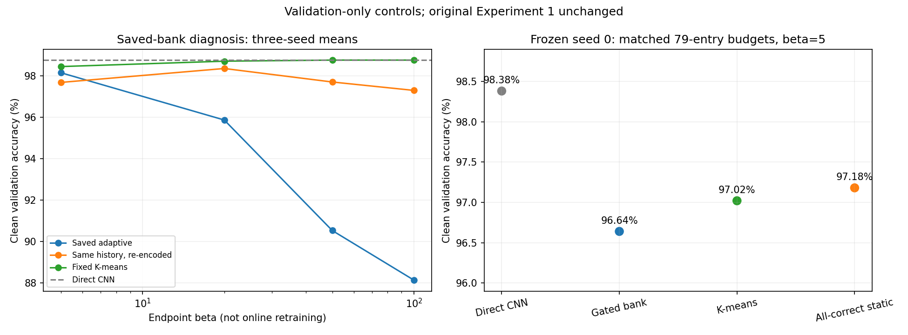

# Experiment 1: diagnosis and fixability

## Verdict

No accuracy-causing implementation defect was identified in the audited paths. The implementation follows the specified eligibility, assignment, EMA and snapshot rules. This does not prove the software has no bugs.
The results identify limitations of the current bank construction and retrieval design. They do not establish that associative memory, or all online memory methods, are fundamentally unfixable. The original selective rule has not demonstrated superiority.

## Evidence actually collected

- Audited 660,000 post-warm-up example records and 4,555 actual mutations across three saved runs. Source IDs/classes, correctness decisions, batch snapshot consistency, nearest same-class assignment, thresholds, EMA values and final bank values passed the audit.
- Retrieval agreed with an independent float64 expression on real validation queries. The shared affine classifier agreed with convex averaging of its memory logits within floating-point precision.
- New evaluation opened only the official training dataset and stored validation IDs. Primary checkpoints/banks/results were preserved. No new test-set evaluation or tuning was performed.

## 1. Sharper retrieval is not a simple fix

Post-training clean validation accuracy, mean across seeds 0/1/2:

| Readout beta | Saved adaptive bank | Fixed K-means bank |
|---|---:|---:|
| 5 | 98.160% | 98.460% |
| 20 | 95.873% | 98.720% |
| 50 | 90.527% | 98.773% |
| 100 | 88.127% | 98.773% |

The direct CNN mean is 98.773%. These are endpoint readout diagnostics, not online methods retrained at each beta. Sharpening exposes poor nearest-memory decisions in the saved adaptive bank; simply increasing beta is rejected as a fix for that bank.

## 2. Drift exists, but removing it did not solve the problem

Re-encoding exactly the same accepted history with the final encoder, preserving the original center, improves hard-readout validation accuracy from 85.260% to 96.800%. That supports a coordinate-mismatch effect. It is not a real online refresh experiment.
At beta=5, value-only refresh instead lowers mean clean validation accuracy from 98.160% to 97.693%. Its beta=20 readout reaches 98.367%. Neither refresh nor sharpening is a universal independent fix.
An actual training control continued seed 0 from the same warm-up checkpoint, including Adam and shuffle state, with the encoder frozen and the same classifier still learning through direct CE. Encoder weights remained exactly unchanged and the head updated. Final clean validation accuracy was 98.380% direct versus 96.640% adaptive. The gap remains without encoder drift. This control has one seed and is not a direct absolute-accuracy comparison with the differently trained primary CNN.

## 3. Bank construction matters even in the same frozen space

Same frozen seed-0 CNN/head, train/validation data, center (exact zero difference), per-class slot counts and beta=5. All three banks have 79 entries:

| Bank | Clean validation accuracy | Mean own-class logit margin of stored entries |
|---|---:|---:|
| adaptive_during_training | 96.640% | 3.091 |
| kmeans_matched_slots | 97.020% | 9.275 |
| all_correct_static_stream | 97.180% | 9.294 |

The direct path is 98.380%. Alternative construction improves the bank but does not close the direct-path gap. A larger margin means the classifier reads an entry more clearly as its stored class.
The all-correct stream is a static endpoint construction control, not CNN training rerun with a different admission rule. It differs in update frequency and classifier timing. It supports a bank-quality explanation, not proof that admission alone caused the gap.

## 4. The current design cannot guarantee preservation of CNN decisions

The bank is updated mainly for retrieval failures, yet replaces the representation of every example. A correction-focused set of prototypes need not represent all ordinary inputs well. This is a likely design mismatch, not a demonstrated single cause.
In the already published clean test results, memory repaired 96 errors but introduced 221 across three 10,000-image evaluations. Those are historical results, not a new test evaluation.
Class capacity blocked 2,842/7,367 eligible candidates (38.6%). Only 540/4,525 actual post-bootstrap writes were followed by a correct immediate local prediction (11.9%). These diagnostics do not prove that capacity or alpha changes would improve held-out performance.
Cosine scoring discards query radius. A synthetic counterexample shows two vectors with identical centered direction but different affine-classifier decisions receiving identical retrieval weights and outputs. The scoring interface therefore cannot preserve every possible direct-CNN decision, even with correct code. This proves a general limitation, not that radius loss causes most observed MNIST errors.

## What is fixable and what remains unknown

- Bank content can be improved: the matched construction controls demonstrate this, although they still trail the direct CNN.
- An accuracy-causing mathematical/API/training-order bug was not found. Replacing the specified rules would be a new design variant, not a correction of a proven accuracy bug.
- The next useful causal test is genuine during-training all-direct-correct admission, with the encoder still learning, otherwise identical budget/EMA/assignment/shuffle, and validation-only settings. The static result does not establish its outcome.
- Later variants can test representative initialization, a metric preserving relevant magnitude, or selective use of retrieval. Use distinct variant IDs; true labels must never route deployment predictions.
- Beta tuning, freezing, more slots and a larger EMA step are not guaranteed wins. More seeds and a properly separated test evaluation are needed to claim an improved method.

## Reproduce

The versioned metrics and plot below are exported from the completed runs.
Reproducing the saved-bank controls requires the corresponding full checkpoints
and compressed logs under local `results/`; those large artifacts are not
included in Git. A new primary run can be created with the command in
[README](README.md#run), then its output directory supplied to the controls.

```powershell
python -B "experiment-id 1/diagnose_memory.py" --run-dir <full_run_directory>
python -B "experiment-id 1/frozen_encoder_control.py" --run-dir <full_run_directory> --seed 0
python -B "experiment-id 1/diagnose_bank_selection.py" --frozen-control <frozen_control_directory>
python -B -m pytest tests "experiment-id 1/tests" -q
```

[Readout data](recorded_results/readout_diagnosis.json) |
[Frozen control](recorded_results/frozen_encoder.md) |
[Matched comparison](recorded_results/matched_banks.md) |
[Primary results](RESULTS.md)


