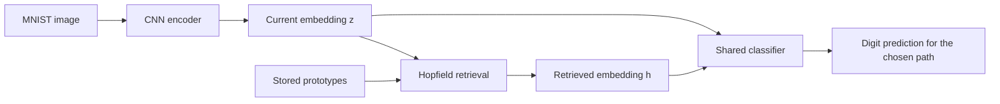
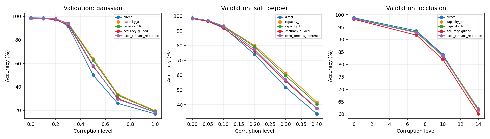
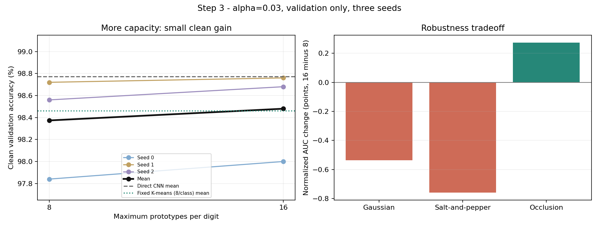
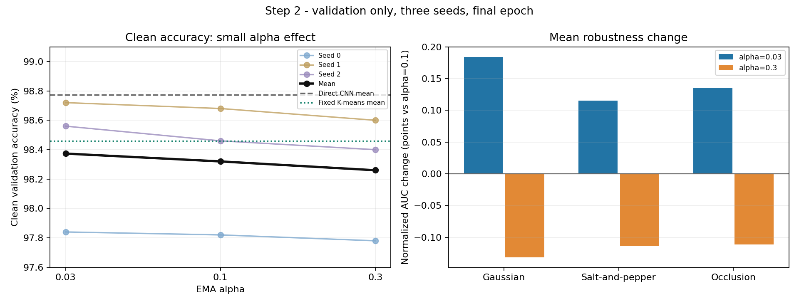

# Adaptive Hopfield Memory Presentation Guide

Prepared for the presentation on 5 November 2026.

Our research question is whether a small memory that adapts while a CNN learns can improve recognition, especially when the input is noisy. We compared the direct CNN, an adaptive Hopfield memory, and a fixed memory constructed with K-means. We then investigated the original weaknesses and tested changes to admission, update strength, and capacity.

The central finding is that the improved adaptive method has promising Gaussian and salt-and-pepper noise results, while clean-image accuracy remains below the direct CNN. The best setting depends on the objective: eight prototypes per digit is better for those two noise families, while sixteen improves clean accuracy and occlusion robustness. The later improvements are validation results; their final test evaluation is still pending.

## 1 The idea behind the experiment

A CNN learns to turn an image into a useful internal representation and then classify that representation. A noisy image can produce an internal representation that is less useful for classification. We asked whether a memory of training representations could provide a better representation for the classifier.

Imagine a handwritten 7. A clean 7 may be easy for the CNN to recognize. After adding noise, its internal representation may become ambiguous. The memory searches for stored representations similar to the current representation and combines them. The hope is that this combination retains useful digit structure and reduces the effect of noise.

That is a hypothesis, not a guarantee. A clean representation may already be excellent. Replacing it with a memory combination can remove useful details and introduce an error.

The general retrieval idea is related to modern continuous Hopfield networks and attention: similarities determine weights over stored patterns. Our experiment uses a single softmax retrieval update. The background reference is [Hopfield Networks is All You Need](https://arxiv.org/abs/2008.02217).

**How to say it aloud:**

> We wanted to test whether a CNN could benefit from a small adaptive memory of useful internal representations. Instead of relying only on the representation of the current image, the model can consult stored prototypes. Our main interest is whether this helps when noise makes the current representation unreliable.

## 2 What the CNN and memory contain

### The hidden representation

Our CNN takes a grayscale 28 by 28 MNIST image and produces a vector containing 64 numbers. This vector is called an embedding or hidden representation. It is not the predicted digit. A classifier turns those 64 numbers into ten scores, one for each digit.

The encoder uses two convolutional stages with pooling, followed by fully connected layers. The final classifier is a linear layer from 64 dimensions to ten class scores.

We can write the direct path as:

```text
Image -> CNN encoder -> 64-number vector z -> classifier -> predicted digit
```

### The prototypes

A prototype is a stored vector representing some training examples. Different prototypes for one digit can cover different handwriting styles. For example, several prototypes of 7 could represent different slants or stroke shapes. These are useful illustrations of what multiple prototypes can represent; we did not assign a handwriting-style label to each actual slot.

The original capacity is eight prototypes per digit. With ten digits, the bank can hold at most 80 prototypes. Eight is a limit, not a requirement that every class always fills all eight slots. Bootstrap starts with only one prototype for each class.

The prototypes are registered buffers that change through explicit writes. They are not neural-network parameters trained by backpropagation. The memory adapts through supervised admission and an update formula.

### The two prediction paths



The direct path applies the classifier to `z`. The memory path applies the same classifier, with exactly the same weights, to the retrieved vector `h`. We evaluate these as separate methods. The current experiment does not automatically choose the correct path for each image.

When we say that memory replaces the hidden vector, we mean that the memory prediction uses `h` where the direct prediction uses `z`. The original vector is still available, and the CNN is not overwritten. Its training loss still uses `z`.

## 3 The three methods we compare

| Method | Source of the vector given to the classifier | When its memory is built |
| --- | --- | --- |
| Direct CNN | The current image embedding | No memory |
| Adaptive Hopfield | A weighted combination of online prototypes | During training after warm-up |
| Fixed K-means reference | A weighted combination of K-means representatives | After CNN training finishes |

All three methods use the same final encoder and classifier within a seed. This makes it possible to compare the effect of the memory without attributing the result to a different CNN.

### Why the fixed method uses K-means

Suppose we have thousands of training embeddings for digit 7. Storing every embedding would require more memory and retrieval work. K-means divides these embeddings into eight groups and calculates one representative vector for each group. We repeat this separately for every digit.

K-means uses Euclidean distance during this post-training construction. It produces a compact reference bank of 80 representatives. It does not run every time a test image arrives.

At evaluation time, the fixed method uses Hopfield retrieval across those stored representatives. It uses centered cosine scores, just as the adaptive readout does. It does not ask K-means to assign a new test image to a cluster.

### Why the adaptive method does not use K-means

During supervised training, we already know the true digit of each candidate. That label tells us which class may receive a write. We then find the nearest stored prototype within that class, using centered cosine distance. There is no need to discover the candidate's class through clustering.

At validation and test time, retrieval searches all active prototypes across all classes. It does not receive the true label, select a class using the label, or predict by voting over stored labels. The shared classifier reads the retrieved vector.

K-means is one way to choose representatives; it is not a requirement for all memory systems. A bank could store selected individual embeddings instead, with different storage and representation tradeoffs.

## 4 How the adaptive bank is built

### Warm-up

The first epoch trains only the direct CNN on clean images. The memory stays empty. One epoch means one complete pass over the selected training images; it is not one image or one minibatch.

At the end of warm-up, we extract all selected training embeddings without gradients and calculate their mean. This mean is the adaptive center. We freeze it for the rest of the experiment. It is calculated from training data, not validation or test images, and it does not change with bank occupancy.

### Bootstrap

For each missing class, the bank stores the first directly correct embedding that is finite and has a nondegenerate centered direction. Already seeded classes stay unchanged during bootstrap.

The bank becomes ready when every class has an entry. A minibatch that completes bootstrap still uses direct fallback for the entire batch. Genuine memory comparisons start with the following minibatch. We keep these fallback counts separate from actual Hopfield accuracy.

### Active operation

Once ready, the original policy compares direct and memory predictions against the training label:

| Direct prediction | Memory prediction | Original admission decision |
| --- | --- | --- |
| Correct | Wrong | Consider a write |
| Wrong | Correct | Skip because memory helped |
| Correct | Correct | Skip because both were correct |
| Wrong | Wrong | Skip because neither supplied a correct result |

This is why the original experiment is called accuracy-guided. Correctness determines admission; confidence, loss size, and batch accuracy do not override the table.

Step 1 changes this policy to consider every directly correct example, including examples where both paths are correct. Directly incorrect examples remain excluded from memory writes in both policies.

An eligible example is not guaranteed to produce a write: numerical validity, distance, and class capacity still apply.

## 5 Retrieval and the update formula

### Retrieval compares every active prototype

Let `z` be the current image embedding, `m_i` a stored prototype, and `c` the frozen center. We subtract `c` and normalize the resulting vectors for scoring:

```text
u   = (z - c) / max(norm(z - c), epsilon)
v_i = (m_i - c) / max(norm(m_i - c), epsilon)
similarity_i = dot(u, v_i)
weight_i = exp(beta * similarity_i) / sum_j exp(beta * similarity_j)
h = sum_i weight_i * m_i
```

Here `epsilon=1e-8`, `beta=5`, and the sum covers all active entries. Inactive reserved slots are excluded.

Normalization controls the similarity scores. The final weighted sum uses the original raw prototype vectors, rather than the unit vectors. We then apply the shared classifier to `h`.

For illustration, retrieval might produce:

```text
h = 0.65 * one prototype of 7
  + 0.20 * another prototype of 7
  + 0.10 * a prototype of 1
  + 0.05 * a prototype of 9
```

These coefficients weight vectors. They are not predicted class probabilities. The classifier determines the final digit. This example illustrates the calculation; it is not a recorded attention pattern from a particular image.

A larger beta makes weights more concentrated on the highest similarities. A smaller beta spreads attention more broadly. Concentration is useful only when the most similar memories are useful.

### Distance determines whether to merge or add

For writing, we search only the candidate's true class and use:

```text
distance = 1 - centered_cosine_similarity
```

We choose the nearest same-class entry, resolving exact ties by stable entry ID.

| Condition | Action |
| --- | --- |
| Nearest distance is at most 0.2 | Update that prototype using EMA |
| Nearest distance exceeds 0.2 and a class slot is available | Add a new prototype |
| Nearest distance exceeds 0.2 and the class is full | Skip the write |

For example, an eligible digit 7 at distance 0.12 merges into its nearest 7 prototype. At distance 0.35, it creates a separate 7 prototype if there is space. If all class slots are occupied, it is skipped. It never updates a prototype of a different digit.

### Alpha controls the amount of movement

The correct exponential moving average formula is:

```text
m_new = (1 - alpha) * m_old + alpha * z
      = m_old + alpha * (z - m_old)
```

The plus sign moves the old prototype toward the new embedding. Writing `m_old - alpha * (z - m_old)` would move it away; that is not the implemented formula.

For a two-number illustration:

```text
old prototype = [10, 4]
new embedding = [14, 8]

alpha = 0.03 -> updated prototype = [10.12, 4.12]
alpha = 0.10 -> updated prototype = [10.40, 4.40]
alpha = 0.30 -> updated prototype = [11.20, 5.20]
```

The actual vectors contain 64 numbers. Smaller alpha preserves more history per update. Larger alpha reacts more strongly to the latest accepted example. We tuned a constant alpha; we did not train alpha through gradients.

## 6 Training order and experimental setup

Each minibatch produces one differentiable embedding extraction and the original direct CNN logits. Direct cross-entropy is the only CNN training loss.

We take a bank snapshot, calculate all direct and memory correctness decisions against that snapshot, and then process eligible candidates in minibatch order without gradients. Each candidate is assigned against the current working bank, which includes earlier writes in that batch. After all memory work, the direct loss backpropagates and Adam performs exactly one CNN update.

This ordering means that a memory write cannot retroactively make another example eligible in the same batch. An example rejected by the memory still contributes to direct CNN training.

| Setting | Value |
| --- | --- |
| Dataset | MNIST digits 0 through 9 |
| Training images per seed | 55,000 |
| Validation images per seed | 5,000 |
| Original test images per seed | 10,000 |
| Random seeds | 0, 1, 2 |
| Total epochs | 5 |
| Warm-up epochs | 1 |
| Training batch size | 128 |
| Optimizer | Adam |
| Learning rate | 0.001 |
| Embedding dimension | 64 |
| Original alpha | 0.1 |
| Original class capacity | 8 |
| Retrieval beta | 5 |
| Retrieval updates | 1 |
| Merge distance threshold | 0.2 |
| Memory refresh or eviction | None |
| Device used | CPU with four threads |

CNN training uses clean images. Noise is added for evaluation. The three methods see identical images and corruption realizations within a comparison. Validation and test evaluation are read-only: the bank and CNN do not learn from those images.

The adaptive center is calculated after warm-up. The fixed reference is built from final training embeddings and uses their post-training mean. This difference in center timing is part of the comparison and remains a limitation.

Three seeds represent three randomized runs, including their own splits and training order. Each model's training and validation images are disjoint. Validation splits overlap partly between seeds: 15,000 seed-image evaluations involve 13,814 distinct image IDs.

The original full experiment evaluated the official test set. All later diagnostics and ablations reported below used validation data. We retained the final epoch rather than choosing the best checkpoint.

## 7 The original full experiment

### Question

Does the original direct-correct and memory-wrong admission policy produce a useful online bank, compared with direct classification and a post-training fixed bank?

### Original test results

These numbers are means across three seeds on the official test set. They describe the original method, before broader admission or alpha and capacity tuning.

| Method | Clean accuracy | Gaussian AUC | Salt-and-pepper AUC | Occlusion AUC |
| --- | --- | --- | --- | --- |
| Direct CNN | 98.923% | 0.5810 | 0.7230 | 0.8793 |
| Original adaptive | 98.507% | 0.6089 | 0.7432 | 0.8643 |
| Fixed K-means | 98.680% | 0.6128 | 0.7516 | 0.8757 |

The original adaptive bank improved Gaussian and salt-and-pepper robustness over direct, but lost clean accuracy and occlusion AUC. The fixed reference exceeded the original adaptive bank on all four aggregate metrics.

On clean images, adaptive memory repaired 96 direct errors but introduced 221 new errors across the three 10,000-image evaluations. The net result was 125 additional errors. These evaluations reuse the same official test images across seeds, rather than representing 30,000 distinct images.

The bank finished with 80, 80, and 79 entries. Across three seeds, it accepted 4,555 writes. Capacity blocked 2,842 of 7,367 eligible active candidates, or 38.6%.

### What this established

The result was mixed. Memory already showed a noise benefit, but replacing every query representation was costly on clean images. We therefore investigated whether the weakness came from a code error, stale representations, poor bank content, or inappropriate settings.

Source: [Original results](RESULTS.md).

## 8 Diagnostic experiments before changing admission

### Diagnostic A Sharper retrieval

**Question:** Is beta=5 averaging too many prototypes, and would more concentrated retrieval fix the bank?

We kept the saved banks and CNNs unchanged and evaluated different beta values on validation images.

| Beta | Saved adaptive clean validation accuracy | Fixed K-means clean validation accuracy |
| --- | --- | --- |
| 5 | 98.160% | 98.460% |
| 20 | 95.873% | 98.720% |
| 50 | 90.527% | 98.773% |
| 100 | 88.127% | 98.773% |

Sharpening harmed the original adaptive bank while helping the fixed bank. Concentrating attention on the adaptive bank's closest entries was therefore not a simple repair.

These are saved-bank readout diagnostics, not online training rerun at every beta. In the original accuracy-guided policy, changing beta during training can change admission and the resulting bank. The table isolates the final readout.

### Diagnostic B Reconstructing accepted memories with the final encoder

**Question:** Do old embeddings conflict with the final encoder's representation space?

We re-encoded the accepted training sources using the final encoder and replayed the original entry assignments and EMA history. This changed stored values without reconsidering which examples had been admitted. We separately examined center changes.

With the original center, a hard nearest-entry readout improved from 85.260% to 96.800% mean clean validation accuracy after value reconstruction. This supports a representation-mismatch effect.

However, at the actual beta=5, value-only reconstruction reduced clean accuracy from 98.160% to 97.693%. At beta=20, the reconstructed bank reached 98.367%.

**Interpretation:** stale representations matter, but correcting that mismatch alone did not guarantee a better deployed readout. This endpoint reconstruction is not a completed experiment with periodic refresh during training.

### Diagnostic C Freezing the encoder after warm-up

**Question:** If we prevent encoder drift, does the adaptive deficit disappear?

For seed 0, we continued from the same warm-up checkpoint but froze the encoder. The classifier continued learning through direct cross-entropy. The original admission and memory rules stayed unchanged.

| Method in this frozen-encoder control | Clean validation accuracy |
| --- | --- |
| Direct CNN | 98.380% |
| Adaptive Hopfield | 96.640% |

The gap remained. Encoder drift is therefore not a complete explanation. This control has one seed and uses a differently trained CNN from the primary experiment, so its absolute accuracy should not be compared as if only memory had changed.

### Diagnostic D Different bank construction in the same frozen space

**Question:** Does bank construction matter even when encoder coordinates are fixed?

Using that same final frozen encoder and classifier, we compared three banks with exactly the same center and per-class slot counts. Each had 79 entries.

| Bank construction | Clean validation accuracy |
| --- | --- |
| Original online adaptive | 96.640% |
| K-means with matched slots | 97.020% |
| Static stream of all directly correct training examples | 97.180% |
| Direct path without memory | 98.380% |

Alternative construction improved memory performance but still trailed direct. The static all-correct result motivated a genuine during-training admission experiment. It did not itself establish how online all-correct admission would perform while the encoder continued learning.

Sources: [Diagnosis](DIAGNOSIS.md), [readout controls](recorded_results/readout_diagnosis.md), [frozen control](recorded_results/frozen_encoder.md), and [matched construction](recorded_results/matched_banks.md).

## 9 Step 1 Broader online admission

### Question and change

The original rule admits examples only when the CNN is correct and memory is wrong. Could this ignore useful examples and build a bank focused too narrowly on retrieval failures?

We changed admission to consider every directly correct training example. Both-correct examples became eligible. Directly incorrect examples still could not write.

We kept alpha=0.1, capacity=8, beta=5, the threshold, five total epochs, and the original CNN training trajectory unchanged. This was an actual online experiment with the encoder still learning.

### Results

| Method | Mean clean validation accuracy |
| --- | --- |
| Direct CNN | 98.773% |
| Original accuracy-guided bank | 98.160% |
| All-direct-correct bank | 98.320% |
| Fixed K-means | 98.460% |

Broader admission gained 0.160 percentage points, equivalent to 24 additional correct predictions across 15,000 seed-image evaluations. It improved all three mean robustness AUCs relative to the original bank.

Successful writes increased from 4,555 to 634,526, about 139 times as many. The final banks each contained 80 entries, and all 240 stored vectors were individually classified as their stored digit by the final classifier.

### What we learned

The admission intervention improved the bank, especially for Gaussian and salt-and-pepper robustness, but did not close the clean gap. It changes both example coverage and write frequency, so the result does not isolate which of those mechanisms produced the gain.

**How to say it aloud:**

> Our first real modification was to let the bank learn from every example the CNN classified correctly. We no longer waited for the memory to fail. This produced a modest clean improvement and a larger noise-robustness improvement, although the direct CNN was still better on clean images.

Source: [Step 1 report](STEP01_ADMISSION.md).

## 10 Step 2 Tuning alpha

### Question and change

Does alpha=0.1 move prototypes too strongly toward each accepted example? We compared constant alpha values 0.03, 0.1, and 0.3 using all-direct-correct admission, eight prototypes per digit, and beta=5.

Independent banks received the same actual minibatch embeddings from one shared CNN training trajectory per seed. The alpha=0.1 control exactly reproduced Step 1 after every continued epoch.

### Results

| Alpha | Mean clean validation accuracy | Correct predictions out of 15,000 |
| --- | --- | --- |
| 0.03 | 98.373% | 14,756 |
| 0.1 | 98.320% | 14,748 |
| 0.3 | 98.260% | 14,739 |

Alpha=0.03 won the predeclared clean-first selection. It gained eight correct predictions over alpha=0.1, or about 0.053 percentage points. All three mean robustness AUCs also improved slightly, although per-seed robustness changes were mixed.

### What we learned

A smaller update helped within this grid, while the larger alpha worsened clean accuracy. The improvement was small compared with the remaining 60-error deficit against direct across 15,000 evaluations.

This was hyperparameter tuning of a constant alpha. We did not implement a per-prototype alpha, an adaptive schedule, or an alpha learned by backpropagation. The EMA formula itself passed the audits; changing alpha tests the design choice, rather than correcting a demonstrated formula bug.

Source: [Step 2 report](STEP02_ALPHA.md).

## 11 Step 3 Increasing capacity

### Question and change

Would more prototypes cover useful digit variations that the eight-slot bank cannot retain?

We compared eight and sixteen prototypes per digit with alpha=0.03, all-direct-correct admission, beta=5, and the same five-epoch training protocol. Each bank began empty after warm-up; the larger bank did not receive duplicated prototypes. The eight-slot control exactly reproduced Step 2.

### Results

| Method | Mean clean validation accuracy | Gaussian AUC | Salt-and-pepper AUC | Occlusion AUC |
| --- | --- | --- | --- | --- |
| Adaptive with 8 per digit | 98.373% | 0.628373 | 0.762767 | 0.873693 |
| Adaptive with 16 per digit | 98.480% | 0.623020 | 0.755183 | 0.876438 |

Sixteen slots gained 16 correct predictions across 15,000 evaluations, or about 0.107 percentage points. It repaired 27 eight-slot errors and introduced 11 new errors. The larger banks ended with 159, 160, and 160 active entries.

### What we learned

More capacity helped clean accuracy and occlusion AUC but reduced Gaussian and salt-and-pepper AUC in every seed. It also nearly doubled bank tensor storage, from 22,016 to 43,776 bytes per seed, excluding serialized metadata and the rest of the program.

The earlier clean-first selection chose sixteen. For our current emphasis on Gaussian and salt-and-pepper noise, eight remains the stronger measured baseline. There is no single capacity that wins every objective.

The sixteen-slot adaptive bank slightly exceeds the eighty-entry fixed reference on clean validation accuracy, 98.480% versus 98.460%. This is not a comparison at equal memory capacity. A fixed reference with sixteen representatives per digit would be needed to assess that claim fairly.

Source: [Step 3 report](STEP03_CAPACITY.md).

## 12 What the current noise results show

The following table contains validation accuracy, averaged over three seeds. Both adaptive methods use all-direct-correct admission, alpha=0.03, and beta=5. The fixed reference has eight prototypes per digit.

| Input condition | Strength | Direct CNN | Fixed K-means | Adaptive 8 | Adaptive 16 |
| --- | --- | --- | --- | --- | --- |
| Clean | 0 | 98.77% | 98.46% | 98.37% | 98.48% |
| Gaussian | 0.1 | 98.61% | 98.33% | 98.31% | 98.41% |
| Gaussian | 0.2 | 97.79% | 97.91% | 97.59% | 97.77% |
| Gaussian | 0.3 | 91.70% | 93.87% | 94.27% | 94.15% |
| Gaussian | 0.5 | 50.03% | 58.21% | 64.15% | 62.80% |
| Gaussian | 0.7 | 25.79% | 29.47% | 33.71% | 32.89% |
| Gaussian | 1.0 | 16.95% | 18.26% | 19.55% | 19.04% |
| Salt-and-pepper | 0.05 | 96.75% | 96.95% | 96.91% | 96.96% |
| Salt-and-pepper | 0.1 | 92.34% | 92.89% | 93.27% | 93.21% |
| Salt-and-pepper | 0.2 | 74.03% | 77.51% | 79.97% | 79.16% |
| Salt-and-pepper | 0.3 | 51.86% | 56.81% | 61.21% | 59.59% |
| Salt-and-pepper | 0.4 | 33.85% | 37.63% | 41.87% | 40.62% |
| Occlusion | 7 | 93.59% | 92.89% | 92.86% | 93.11% |
| Occlusion | 10 | 83.98% | 83.43% | 83.33% | 83.60% |
| Occlusion | 14 | 61.36% | 61.83% | 61.46% | 62.10% |

Gaussian strength is the noise standard deviation in raw pixel space, with results clamped to the image range. Salt-and-pepper strength is the probability that a pixel is replaced with black or white. Occlusion strength is the side length of a randomly positioned black square, in pixels.

### The clearest example

At Gaussian sigma=0.5:

- Direct CNN accuracy is 50.03%.
- Fixed K-means accuracy is 58.21%.
- Adaptive with eight per digit reaches 64.15%.
- Adaptive with sixteen per digit reaches 62.80%.

The eight-slot adaptive method gains **14.12 percentage points over direct** and **5.93 points over fixed**. This is a meaningful observed validation advantage under this corruption condition. At more extreme noise, absolute accuracy remains low for every method even when adaptive is relatively better.

At salt-and-pepper probability 0.3, adaptive eight reaches 61.21%, versus 51.86% direct and 56.81% fixed. At mild Gaussian noise, adaptive does not improve over direct. Occlusion is mixed across strengths.

### Understanding robustness AUC

Robustness AUC summarizes the accuracy curve over increasing corruption severity. We integrate over the configured severity range and normalize by that range, so the result is on a zero-to-one scale and higher is better. It is not ROC AUC and not accuracy at one noise level.

| Method | Gaussian AUC | Salt-and-pepper AUC | Occlusion AUC |
| --- | --- | --- | --- |
| Direct CNN | 0.573300 | 0.712837 | 0.878779 |
| Original adaptive | 0.601357 | 0.731171 | 0.864310 |
| Broader admission with alpha=0.1 | 0.626530 | 0.761613 | 0.872343 |
| Broader admission with alpha=0.03 and 8 per digit | 0.628373 | 0.762767 | 0.873693 |
| Broader admission with alpha=0.03 and 16 per digit | 0.623020 | 0.755183 | 0.876438 |
| Fixed K-means with 8 per digit | 0.603753 | 0.739717 | 0.874795 |

Adaptive eight has the strongest Gaussian and salt-and-pepper mean AUC among these measured settings. Direct has the strongest occlusion AUC.

Source: [Per-condition results](recorded_results/capacity_step3/results.csv), [alpha results](STEP02_ALPHA.md), and [admission results](STEP01_ADMISSION.md).

## 13 Why clean accuracy can still decrease

### Memory changes a representation that may already be good

Consider a clean 7. The CNN produces a vector that the classifier correctly reads as 7. Retrieval replaces that vector with a mixture of stored vectors. If the mixture includes enough competing-class information or loses a useful detail, the classifier may read it as 1.

An update on that training example moves a same-class prototype toward the correct vector. It does not optimize the query's classification loss through the retrieval operation or guarantee a correct prediction afterward. The query still competes with every other active prototype, and a local modification can affect other queries.

The right explanation is that the complete bank and readout need to preserve useful information. It is too narrow to say that EMA alone is the proven cause.

### Stored vectors and the model can become inconsistent

The CNN and classifier continue learning after warm-up. A stored embedding was created by an earlier encoder, and a later classifier can interpret it differently. EMA only changes a prototype when that prototype receives an accepted write. A slot receiving no writes does not refresh itself.

In the larger bank, one stored digit-6 entry had only two accepted exposures, both from the same training image. Its last update was 792 optimizer steps before training ended, and the final classifier no longer classified that stored vector as 6. This is a concrete low-support entry to investigate.

Its exact classification-change time and effect on validation accuracy are unknown. All eight-slot prototypes were individually classified correctly, yet that bank still had a clean deficit. One rare larger-bank entry cannot explain the entire result.

### Scoring deliberately discards some query information

Centered cosine scoring depends on direction, rather than the centered vector's magnitude. Two queries with the same centered direction receive the same weights, even if the direct affine classifier would distinguish them using magnitude. This creates a general limitation on preserving every direct decision. It does not establish how much of the observed MNIST deficit this mechanism caused.

### More prototypes introduce tradeoffs

Additional entries change coverage, assignments, update frequency, support per entry, and retrieval competition. They need not monotonically improve accuracy. Our capacity experiment demonstrates this: clean improves while Gaussian and salt-and-pepper robustness worsen.

## 14 How we checked the implementation

The latest full regression suite passed **467 tests**. Checks cover the admission table, exact EMA math, same-class assignment, class capacity, inactive-slot exclusion, label-independent retrieval, gradient separation, deterministic epoch resume, and read-only evaluation.

We also replayed real memory mutations from the recorded events and recovered the final banks exactly. In the capacity study, all six final banks replayed exactly, with 1,320,000 exposure records and 1,274,111 successful mutations audited. All twelve continued CNN, optimizer, shuffle, and eight-slot bank checkpoints matched their saved controls.

These checks found no accuracy-causing implementation defect in the audited paths. They support treating the remaining accuracy gap as a design question rather than claiming that a discovered code bug explains it. They do not establish that every possible bug has been excluded.

All experiment code, reports, and outputs stay inside `experiment-id 1`. The original `src` and existing benchmark files were not changed for this work.

## 15 What we can claim and what remains uncertain

We can claim that broader admission improved the original adaptive bank, alpha=0.03 gave a small further gain, and more slots produced a clean-versus-noise tradeoff. We can also claim a clear measured validation benefit for adaptive memory on moderate and heavy Gaussian and salt-and-pepper corruption.

We cannot claim that adaptive is better for every input, that the later variants have established a test-set improvement, or that three seeds provide strong across-seed statistical evidence. The same validation sets were reused across stages, so the tuned validation numbers may be optimistic. The fixed comparator also uses a different center timing, and the sixteen-slot comparison has a larger budget than the fixed reference.

The staged clean validation progression is:

| Stage | Adaptive clean validation accuracy | Additional errors relative to direct across 15,000 evaluations |
| --- | --- | --- |
| Original admission | 98.160% | 92 |
| Broader admission | 98.320% | 68 |
| Alpha=0.03 | 98.373% | 60 |
| Sixteen prototypes per digit | 98.480% | 44 |

Direct accuracy stays 98.773% throughout these comparisons because the CNN trajectory is unchanged. The memory improved, but the clean gap remains.

## 16 Next experiments in priority order

For the current noise-first goal, the proposed next baseline is all-direct-correct admission, eight prototypes per digit, alpha=0.03, and beta=5. The following experiments are proposed; their outcomes are not yet known.

| Priority | Experiment | Question it would answer |
| --- | --- | --- |
| 1 | Controlled online memory refresh | Does keeping stored representations current improve noise performance without losing existing benefits? |
| 2 | Blend the direct and retrieved representations | Can we retain useful current-image information while benefiting from memory? |
| 3 | More representative initialization | Does a better starting bank improve coverage and later adaptation? |
| 4 | Longer training | Do additional epochs improve the bank, or only increase staleness and fitting? |
| 5 | Final fixed-configuration test evaluation | Do the selected validation gains generalize to the official test set? |

The final test evaluation is essential, but it follows configuration selection rather than serving as a tuning tool. The previous endpoint refresh diagnostic was mixed, so online refresh should be treated as a hypothesis to test, rather than a known solution.

A possible blend would use `h_blend = (1 - lambda) * z + lambda * h`, where lambda=0 gives direct and lambda=1 gives full retrieval. No blending result has been measured. Because direct is weaker under some noise conditions, blending may also weaken the memory benefit; validation must decide.

## 17 Suggested presentation order

For a presentation of about fifteen to twenty minutes, use this order and explain the detailed mathematics only as needed:

| Slide | Subject | Main message |
| --- | --- | --- |
| 1 | Research question | Can adaptive memory improve a CNN under noise? |
| 2 | Hidden representations and prototypes | We store 64-number vectors, with several per digit. |
| 3 | Three compared methods | Direct, online adaptive, and post-training fixed K-means. |
| 4 | Memory lifecycle and writes | Warm-up, bootstrap, correctness-based admission, merge or add. |
| 5 | Training and evaluation protocol | Same CNN, direct-only loss, clean training, paired corruptions. |
| 6 | Original results | Some noise benefit, but clean and occlusion costs. |
| 7 | Diagnostic controls | Sharpening and removing encoder drift did not solve the gap. |
| 8 | Broader admission | Learning from all directly correct examples improved the bank. |
| 9 | Alpha and capacity | Smaller alpha helped slightly; more capacity changed the tradeoff. |
| 10 | Current noise results | At Gaussian 0.5: 50.03% direct, 58.21% fixed, 64.15% adaptive eight. |
| 11 | Limitations | Clean deficit, reused validation, three seeds, stale representations. |
| 12 | Next steps | Test refresh and blending, then evaluate a frozen choice on test data. |

## 18 Questions you may be asked

### Does adaptive mean the memory is trained by gradient descent

No. The CNN learns through direct cross-entropy. The bank changes through explicit seed, add, and EMA operations. We did not use optimizer-trained memory parameters.

### Does the memory keep adapting to test images

No. Online means it adapts during supervised training. Validation and test inference are read-only in this experiment.

### Why does the bank know the class during a write

Training images have labels. We use the true label to constrain the write to that class. During retrieval, the true label is unavailable to the bank and does not route the query.

### Does retrieval select one of the eighty prototypes

With beta=5, it calculates a softmax weight over all active prototypes and combines their raw vectors. It is not simply a nearest-neighbor decision, a memory-label vote, or K-means clustering at test time.

### If the CNN is correct why use memory at all

We do not know whether the CNN is correct for an unseen image without its label. The original method evaluates full memory replacement as a separate prediction path. Training labels guide admission but cannot be used to choose the correct path at deployment. A future blend or gate would need a rule available without the true label.

### Can all prototypes be correct and retrieval still be wrong

Yes. A prototype's own classification checks its individual vector. Query retrieval combines vectors from multiple classes according to similarity. That mixture may classify incorrectly even when every individual prototype matches its stored label.

### Is alpha tuning the final solution

Within the tested values, alpha=0.03 helped slightly. It left sixty extra clean errors relative to direct across the three evaluations. It is a useful setting, not a complete solution or proof about every possible alpha strategy.

### Should we always choose sixteen prototypes

No. Sixteen improved clean accuracy and occlusion AUC. Eight was better for Gaussian and salt-and-pepper AUC, which now matters most to us. Capacity should follow the intended use case.

### Why not train for more epochs immediately

More epochs may help, but training the CNN longer on clean images does not directly solve stale memories or information lost through retrieval. Existing validation curves do not establish that longer training will improve the memory. It remains a separate experiment.

### Was the poor result an implementation error

We did not find an accuracy-causing defect in the audited code paths. Policy, math, replay, and training-parity checks passed. The evidence points toward limitations of the current recipe, while leaving room for additional implementation review.

### Does this mean Hopfield memory is a bad idea

No. The adaptive bank already improves several noise conditions, and changing its policy improves its results. The evidence shows a tradeoff in this particular design, rather than proving that associative memory cannot work.

### What does a gain of fourteen percentage points mean

At Gaussian sigma=0.5, accuracy rises from about fifty to about sixty-four correct predictions per hundred evaluated images, averaged across seeds. The gain is fourteen percentage points. It is not a claim of fourteen percent relative improvement or a guarantee for every group of one hundred images.

### Which results are test results

The original three-method experiment has official test results. The beta, reconstruction, frozen-encoder, bank-construction, admission, alpha, and capacity follow-ups reported here use validation data. We must not compare their absolute validation accuracy with the original test accuracy as if the datasets were identical.

## 19 A short opening you can read aloud

> Our project investigates whether an adaptive Hopfield memory can improve a CNN, especially when the input contains noise. The CNN converts each MNIST image into a vector of sixty-four numbers. We store a small collection of these representations as prototypes. At prediction time, the memory compares the current vector with stored prototypes and returns a weighted combination for the same classifier to read.
>
> We compare three methods: the direct CNN, an adaptive bank updated during training, and a fixed bank constructed with K-means after training. The CNN itself always learns through direct cross-entropy. Memory updates are explicit and do not backpropagate into the CNN.
>
> Our original result was mixed: memory improved some noise conditions but reduced clean accuracy. We investigated sharper retrieval, representation drift, and bank construction, then tested broader admission, smaller update strength, and larger capacity. The strongest noise setting so far uses eight prototypes per digit and alpha zero point zero three. On Gaussian noise with sigma zero point five, it reaches sixty-four point one five percent validation accuracy, compared with fifty point zero three percent for direct and fifty-eight point two one percent for fixed memory.

## 20 A closing you can read aloud

> The experiment shows that adaptive memory can provide a useful robustness benefit, but how we build and read the bank matters. Broader admission improved the bank, a smaller alpha helped slightly, and more capacity improved clean accuracy while weakening Gaussian and salt-and-pepper robustness. The direct CNN still has the best clean accuracy.
>
> Our current conclusion is that the adaptive method is promising for certain noise conditions, with a remaining cost on clean images. The next steps are controlled refresh and blending experiments, followed by test evaluation after the configuration is fixed. We have not established a universal improvement, but we have identified useful gains and specific limitations to investigate.

## 21 Reports and figures for preparation

- [Original full experiment](RESULTS.md)
- [Diagnostic controls and interpretation](DIAGNOSIS.md)
- [Step 1 admission comparison](STEP01_ADMISSION.md)
- [Step 2 alpha comparison](STEP02_ALPHA.md)
- [Step 3 capacity comparison](STEP03_CAPACITY.md)
- [Current structured results and paired metrics](recorded_results/capacity_step3/results.json)
- [Current per-condition accuracy table](recorded_results/capacity_step3/results.csv)
- [Background paper on modern Hopfield networks](https://arxiv.org/abs/2008.02217)






