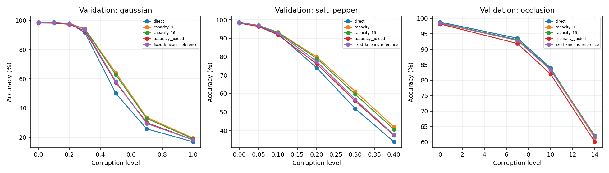
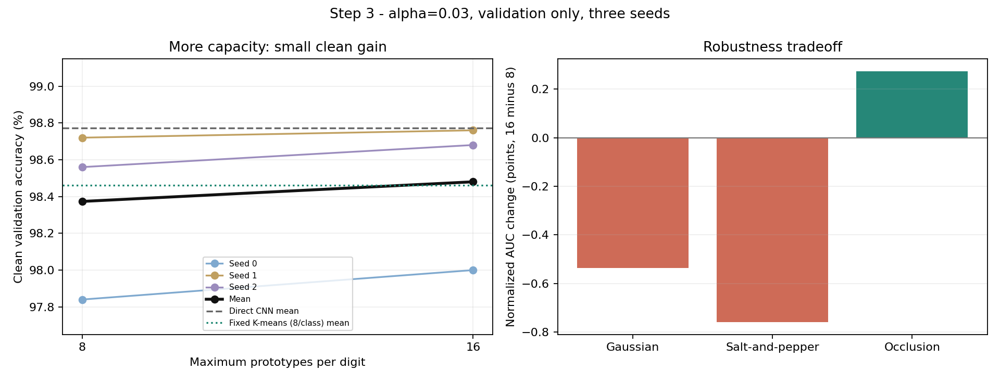
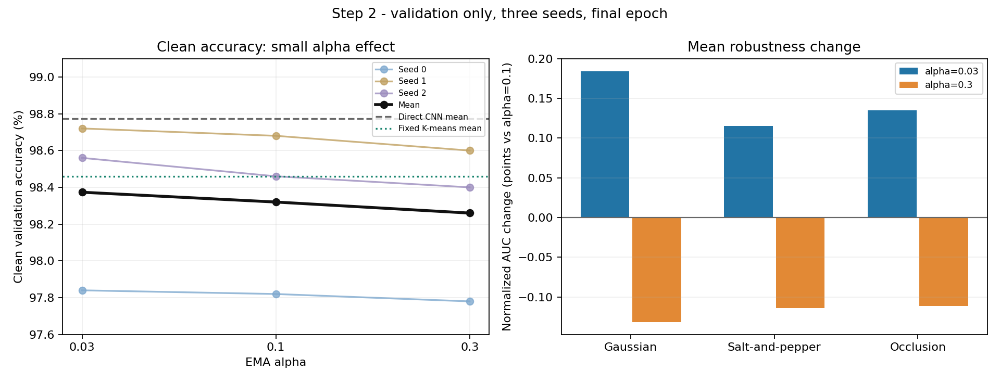

# Adaptive Hopfield experiment results

This is the consolidated report for Experiment 1, `exp_001_online_accuracy_guided_memory`. It covers the original MNIST test experiment, validation-only diagnostic controls, and the completed admission, alpha, and capacity comparisons.

**Main finding:** adaptive memory improves moderate and heavy Gaussian and salt-and-pepper noise performance, while direct CNN clean accuracy remains higher. Broader admission improves the original bank; alpha=0.03 gives a small further gain. Sixteen prototypes per digit improves clean accuracy and occlusion AUC, while eight remains stronger for Gaussian and salt-and-pepper AUC.

The original experiment has official test results. All later comparisons below are validation results, not new test results. Configuration selection used validation data; the final test evaluation of the newer variants is still pending. Three seeds support descriptive comparisons, not strong across-seed statistical claims.

## Method and shared settings

The direct CNN converts an MNIST image into a 64-dimensional embedding and applies a shared linear classifier. The adaptive path uses Hopfield retrieval to combine stored embeddings, then applies that same classifier. CNN gradients come exclusively from direct cross-entropy. Bank buffers have no optimizer parameters or gradient path to the CNN.

| Setting | Value |
| --- | --- |
| Seeds | 0, 1, 2 |
| Images per seed | 55,000 training; 5,000 validation; 10,000 original test |
| Total epochs | 5, including one warm-up epoch |
| Optimizer and learning rate | Adam, 0.001 |
| Training and evaluation batch sizes | 128 and 256 |
| Embedding dimension | 64 |
| Retrieval beta and updates | 5 and 1 |
| Original alpha and class capacity | 0.1 and 8 |
| Merge threshold | 0.2 |
| Normalization epsilon | 1e-8 |
| Refresh and eviction | None |
| Device used | CPU, four threads |

Training uses clean images; evaluation adds seeded Gaussian, salt-and-pepper, or occlusion corruptions. All methods receive the same examples and corruption realizations within a comparison. Validation and test evaluation are read-only. The final epoch is retained without checkpoint search.

**Warm-up and bootstrap.** The bank stays empty during warm-up. At the boundary, a no-gradient extraction over the selected training split freezes the mean embedding as the adaptive center. Each missing class receives its first finite, nondegenerate, directly correct embedding. Already seeded classes remain unchanged until bootstrap completes. The completing batch remains direct fallback throughout; genuine comparisons start next batch. Incomplete banks report unavailable Hopfield accuracy rather than counting fallback as successful retrieval.

**Original admission.** Direct-correct/Hopfield-wrong candidates may influence memory. Direct-wrong/Hopfield-correct, both-correct, and both-wrong examples are skipped. Broader admission also permits both-correct examples. Directly incorrect examples remain excluded from memory writes, but every example contributes to direct CNN training.

**Retrieval.** Similarity uses normalized `(query - center)` and `(memory - center)`. Softmax with beta=5 produces weights over every active entry across all classes. The output is the weighted sum of raw memories; stored labels do not vote or route retrieval. Inactive slots are excluded.

**Assignment and mutation.** Training labels constrain writes to the candidate's class. Select its nearest same-class entry by centered cosine distance `1 - cosine`, breaking exact ties by stable entry ID. At distance <=0.2, merge using `new = (1-alpha)*old + alpha*candidate`. Above the threshold, add if space remains; otherwise skip without eviction. Candidate and proposed EMA values must be numerically valid.

**Batch order.** Compute all correctness decisions against one pre-write snapshot. Process eligible candidates in minibatch order, reassigning against the working bank after earlier writes. Only afterward backpropagate direct loss and perform one CNN optimizer update. Diagnostic predictions never cause repeated admission.

**Fixed reference.** After training, per-class Euclidean K-means constructs eight representatives per digit from final training embeddings. Retrieval uses centered cosine scoring, beta=5, one update, and the same classifier. Its center is the post-training training mean; the adaptive center remains the warm-up mean. K-means never initializes or refreshes the adaptive bank.

**Metrics.** Accuracy, per-class accuracy, confusion, paired helped/harmed counts, and McNemar statistics are recorded. Normalized robustness AUC integrates accuracy over the configured corruption range on a 0-1 scale; higher is better. It is not ROC AUC. Helped means direct wrong/memory correct; harmed means direct correct/memory wrong, with `delta_accuracy=(helped-harmed)/N`.

## Original test experiment

Source run: `dcee52a0d8484d75a46cc9b426940a39`. These are the original accuracy-guided method's official test results, before the later admission, alpha, and capacity comparisons.

### Main result

The direct CNN has the highest mean clean accuracy and occlusion robustness AUC. Adaptive memory improves Gaussian and salt-and-pepper robustness over direct, but reduces clean and occlusion performance. The fixed K-means reference exceeds adaptive memory on all four aggregate metrics below. Three seeds support descriptive comparisons, not strong across-seed statistical claims.

| Method | Clean accuracy mean +/- sample SD | Gaussian AUC | Salt-and-pepper AUC | Occlusion AUC |
| --- | --- | --- | --- | --- |
| Direct CNN | 98.923% +/- 0.231 pp | 0.5810 | 0.7230 | 0.8793 |
| Adaptive Hopfield | 98.507% +/- 0.251 pp | 0.6089 | 0.7432 | 0.8643 |
| Fixed K-means | 98.680% +/- 0.052 pp | 0.6128 | 0.7516 | 0.8757 |

AUC is normalized area under accuracy versus corruption severity on a 0-1 scale; higher is better. It is not ROC AUC.

| Seed | Direct CNN | Adaptive Hopfield | Fixed K-means |
| --- | --- | --- | --- |
| 0 | 98.66% | 98.23% | 98.71% |
| 1 | 99.09% | 98.72% | 98.62% |
| 2 | 99.02% | 98.57% | 98.71% |

### Corruption accuracy: means across seeds

| Corruption | Level | Direct CNN | Adaptive Hopfield | Fixed K-means |
| --- | --- | --- | --- | --- |
| Clean | 0 | 98.92% | 98.51% | 98.68% |
| gaussian | 0.1 | 98.84% | 98.34% | 98.64% |
| gaussian | 0.2 | 98.06% | 97.57% | 98.18% |
| gaussian | 0.3 | 92.36% | 93.39% | 94.76% |
| gaussian | 0.5 | 51.14% | 58.90% | 60.01% |
| gaussian | 0.7 | 27.01% | 31.19% | 30.83% |
| gaussian | 1.0 | 17.56% | 18.61% | 18.25% |
| salt_pepper | 0.05 | 97.28% | 96.78% | 97.34% |
| salt_pepper | 0.1 | 92.94% | 92.75% | 93.82% |
| salt_pepper | 0.2 | 75.55% | 77.70% | 79.29% |
| salt_pepper | 0.3 | 53.26% | 57.80% | 58.62% |
| salt_pepper | 0.4 | 34.60% | 38.43% | 38.08% |
| occlusion | 7 | 93.62% | 92.13% | 93.00% |
| occlusion | 10 | 83.77% | 81.25% | 83.19% |
| occlusion | 14 | 61.72% | 60.11% | 62.23% |

Gaussian levels are sigma; salt-and-pepper levels are probabilities; occlusion levels are square side lengths in pixels.

### Clean per-digit accuracy: means across seeds

| Digit | Direct CNN | Adaptive Hopfield | Fixed K-means |
| --- | --- | --- | --- |
| 0 | 99.52% | 99.01% | 99.35% |
| 1 | 99.62% | 99.06% | 99.41% |
| 2 | 99.19% | 98.68% | 99.22% |
| 3 | 99.31% | 98.38% | 99.24% |
| 4 | 98.37% | 98.51% | 98.64% |
| 5 | 98.84% | 98.65% | 98.77% |
| 6 | 98.92% | 99.37% | 99.23% |
| 7 | 98.51% | 97.86% | 98.31% |
| 8 | 99.35% | 97.67% | 97.95% |
| 9 | 97.52% | 97.85% | 96.60% |

### Paired clean comparisons

| Seed | Method | Helped | Harmed | Delta vs direct (pp) | McNemar p |
| --- | --- | --- | --- | --- | --- |
| 0 | Adaptive Hopfield | 37 | 80 | -0.43 | 8.71744e-05 |
| 0 | Fixed K-means | 42 | 37 | +0.05 | 0.652964 |
| 1 | Adaptive Hopfield | 28 | 65 | -0.37 | 0.000157571 |
| 1 | Fixed K-means | 24 | 71 | -0.47 | 1.4641e-06 |
| 2 | Adaptive Hopfield | 31 | 76 | -0.45 | 1.60286e-05 |
| 2 | Fixed K-means | 25 | 56 | -0.31 | 0.000752126 |

Adaptive repaired 96 direct errors and introduced 221 new errors, giving 125 additional errors over three 10,000-image evaluations. Fixed repaired 91 and introduced 164, giving 73 additional errors. These evaluations reuse the same test images across seeds. McNemar p-values are per seed and unadjusted for multiple comparisons.

### Training and validation

| Epoch | Mean direct CE loss | Validation direct | Validation adaptive |
| --- | --- | --- | --- |
| 1 | 0.1907 | 97.87% | Unavailable |
| 2 | 0.0517 | 98.58% | 97.52% |
| 3 | 0.0343 | 98.66% | 97.95% |
| 4 | 0.0249 | 98.67% | 98.16% |
| 5 | 0.0192 | 98.77% | 98.16% |

Epoch 1 has an empty bank, so genuine Hopfield validation accuracy is unavailable. The final epoch is used for test evaluation. Training-time write diagnostics are in-sample; validation results and final test results have separate denominators.

### Bank, costs, and verification

| Seed | Adaptive entries | Successful writes | Fallback exposures | Capacity skips |
| --- | --- | --- | --- | --- |
| 0 | 80 | 1549 | 128 | 841 |
| 1 | 80 | 1566 | 128 | 1112 |
| 2 | 79 | 1440 | 128 | 889 |

Across all seeds: 660,000 post-warm-up exposures, 659,616 genuine comparisons, 384 bootstrap fallbacks, and 4,555 successful writes (30 seeds, 209 adds, 4,316 merges). Capacity blocked 2,842 of 7,367 eligible active candidates (38.6%). All classes were covered; seed 2 has seven entries for digit 6. Every fixed bank has 80 entries.

Recorded training-loop wall time was 29.96 minutes across three seeds; final test evaluation took 5.35 minutes. Training wall time already includes forward/backward, retrieval, writes, and in-loop diagnostics and logging. Component timers overlap with it and must not be summed as independent costs. CPU with four threads was used.

Each adaptive bank allocated 22,016 bytes of tensors, plus serialized metadata. Recorded checkpoints total 84.84 MiB and compressed logs total 12.45 MiB. Full timing, storage, attention, drift, per-class, confusion, and paired statistics for every seed and corruption condition are retained in [full structured results](recorded_results/full_results.json).

[Verification](recorded_results/verification.json) records unchanged original src, matching source identity, and exact replay of all three final banks from mutation records. The primary manifest records completion; no numerical failure was recorded.

## Validation diagnostic controls

No accuracy-causing implementation defect was identified in the audited paths. Original exposure decisions, assignment, EMA, versions, provenance, and replay passed inspection. Retrieval agreed with an independent float64 expression, and the shared affine classifier agreed with convex averaging of memory logits within floating-point precision. These checks do not exclude every possible software bug.

### Sharper retrieval is not a simple fix

Post-training clean validation accuracy, mean across seeds 0/1/2:

| Readout beta | Saved adaptive bank | Fixed K-means bank |
|---|---:|---:|
| 5 | 98.160% | 98.460% |
| 20 | 95.873% | 98.720% |
| 50 | 90.527% | 98.773% |
| 100 | 88.127% | 98.773% |

The direct CNN mean is 98.773%. These are endpoint readout diagnostics, not online methods retrained at each beta. Sharpening exposes poor nearest-memory decisions in the saved adaptive bank; simply increasing beta is rejected as a fix for that bank.

### Drift exists, but removing it did not solve the problem

Re-encoding exactly the same accepted history with the final encoder, preserving the original center, improves hard-readout validation accuracy from 85.260% to 96.800%. That supports a coordinate-mismatch effect. It is not a real online refresh experiment.
At beta=5, value-only refresh instead lowers mean clean validation accuracy from 98.160% to 97.693%. Its beta=20 readout reaches 98.367%. Neither refresh nor sharpening is a universal independent fix.
An actual training control continued seed 0 from the same warm-up checkpoint, including Adam and shuffle state, with the encoder frozen and the same classifier still learning through direct CE. Encoder weights remained exactly unchanged and the head updated. Final clean validation accuracy was 98.380% direct versus 96.640% adaptive. The gap remains without encoder drift. This control has one seed and is not a direct absolute-accuracy comparison with the differently trained primary CNN.

### Bank construction matters even in the same frozen space

Same frozen seed-0 CNN/head, train/validation data, center (exact zero difference), per-class slot counts and beta=5. All three banks have 79 entries:

| Bank | Clean validation accuracy | Mean own-class logit margin of stored entries |
|---|---:|---:|
| adaptive_during_training | 96.640% | 3.091 |
| kmeans_matched_slots | 97.020% | 9.275 |
| all_correct_static_stream | 97.180% | 9.294 |

The direct path is 98.380%. Alternative construction improves the bank but does not close the direct-path gap. A larger margin means the classifier reads an entry more clearly as its stored class.
The all-correct stream is a static endpoint construction control, not CNN training rerun with a different admission rule. It differs in update frequency and classifier timing. It supports a bank-quality explanation, not proof that admission alone caused the gap.

### The current design cannot guarantee preservation of CNN decisions

The original bank was updated mainly for retrieval failures, yet replaced the representation of every example. A correction-focused set of prototypes need not represent all ordinary inputs well. This is a likely design mismatch, not a demonstrated single cause.
In the already published clean test results, memory repaired 96 errors but introduced 221 across three 10,000-image evaluations. Those are historical results, not a new test evaluation.
Class capacity blocked 2,842/7,367 eligible candidates (38.6%). Only 540/4,525 actual post-bootstrap writes were followed by a correct immediate local prediction (11.9%). These diagnostics do not prove that capacity or alpha changes would improve held-out performance.
Cosine scoring discards query radius. A synthetic counterexample shows two vectors with identical centered direction but different affine-classifier decisions receiving identical retrieval weights and outputs. The scoring interface therefore cannot preserve every possible direct-CNN decision, even with correct code. This proves a general limitation, not that radius loss causes most observed MNIST errors.


## Step 1 Broader online admission

Variant: `exp001_step01_online_all_direct_correct_admission`. Consider every directly correct training example, including both-correct examples. Alpha=0.1, capacity=8, beta=5, assignment, warm-up, and CNN training remain unchanged. This is genuine during-training admission with the encoder still learning, rather than the earlier static endpoint construction.

### Final clean validation accuracy

| Method | Seed 0 | Seed 1 | Seed 2 | Mean +/- sample SD |
| --- | --- | --- | --- | --- |
| Direct CNN | 98.52% | 98.96% | 98.84% | 98.773% +/- 0.227 pp |
| Original accuracy-guided | 97.66% | 98.44% | 98.38% | 98.160% +/- 0.434 pp |
| All directly correct | 97.82% | 98.68% | 98.46% | 98.320% +/- 0.447 pp |
| Fixed K-means | 98.32% | 98.54% | 98.52% | 98.460% +/- 0.122 pp |

New minus original is +0.16, +0.24, and +0.08 percentage points for seeds 0, 1, and 2. The mean gap to direct is still -0.453 percentage points. Final-epoch results are retained even when an earlier checkpoint scored higher.

### Normalized validation robustness AUC

| Method | Gaussian | Salt-and-pepper | Occlusion |
| --- | --- | --- | --- |
| Direct CNN | 0.573300 | 0.712837 | 0.878779 |
| Original accuracy-guided | 0.601357 | 0.731171 | 0.864310 |
| All directly correct | 0.626530 | 0.761613 | 0.872343 |
| Fixed K-means | 0.603753 | 0.739717 | 0.874795 |

Higher is better, on a 0-1 scale. AUC integrates accuracy over the configured corruption grid; it is not ROC AUC. Relative to original admission, the new rule gains 2.517 pp on Gaussian AUC, 3.044 pp on salt-and-pepper AUC, and 0.803 pp on occlusion AUC. Direct still has the highest occlusion AUC.


### Memory behavior and cost

| Seed | Active entries | Successful writes | Prototype own-class checks | Elapsed minutes |
| --- | --- | --- | --- | --- |
| 0 | 80 | 211912 | 80/80 | 31.62 |
| 1 | 80 | 211478 | 80/80 | 43.33 |
| 2 | 80 | 211136 | 80/80 | 34.97 |

The new bank accepted **634,526 writes**, compared with **4,555** originally: **139.3 times as many**. More admissions change update frequency as well as sample coverage. This comparison measures that entire intervention; it does not isolate those two mechanisms.

All 240 new prototypes are individually classified as their stored class by the final classifier. That check does not guarantee that retrieval will classify every query correctly.

Allocated bank tensors remain 22,016 bytes per seed. The per-write diagnostics, full-vector logs, and replay audits add substantial experimental overhead. Worker elapsed times overlap because seeds ran in independent processes; they must not be summed as total wall time. Detailed component costs and log/checkpoint storage are in the structured results.

All twelve continued CNN/Adam/shuffle checkpoints match the original trajectory. All 660,000 exposures and 634,526 mutations were audited; the three final banks replay exactly. The serial worker completed seeds 0/1, and an independent worker completed seed 2; the unfinished duplicate serial seed-2 tail is excluded. Aggregation checks compatible source/data/settings, unique audited seeds, complete histories, and original artifact hashes. The regression suite at this stage passed 427 tests.

## Step 2 Constant alpha comparison

Variant: `exp001_step02_all_correct_alpha_sweep`. Compare alpha=0.03, 0.1, and 0.3 with all-direct-correct admission, eight prototypes per digit, beta=5, and all shared settings fixed. One actual CNN trajectory supplies identical detached minibatch embeddings to independent banks. The alpha=0.1 bank reproduces Step 1 exactly at every continued epoch; no backbone feature cache is used.

The predeclared selection maximizes total correct clean-validation predictions, with exact ties resolved by mean corruption AUC, closeness to alpha=0.1, then smaller alpha. No tie occurred. This tunes a constant alpha, rather than learning alpha through gradients. The original pre-run protocol remains in the exact training source archive.

### Clean validation accuracy

| Method | Seed 0 | Seed 1 | Seed 2 | Mean | Correct / 15,000 |
|---|---:|---:|---:|---:|---:|
| Direct CNN | 98.52% | 98.96% | 98.84% | 98.773% | 14,816 |
| Original accuracy-guided admission, alpha=0.1 | 97.66% | 98.44% | 98.38% | 98.160% | 14,724 |
| All-direct-correct, **alpha=0.03** | **97.84%** | **98.72%** | **98.56%** | **98.373%** | **14,756** |
| All-direct-correct, alpha=0.1 | 97.82% | 98.68% | 98.46% | 98.320% | 14,748 |
| All-direct-correct, alpha=0.3 | 97.78% | 98.60% | 98.40% | 98.260% | 14,739 |
| Fixed K-means reference | 98.32% | 98.54% | 98.52% | 98.460% | 14,769 |

Against alpha=0.1, alpha=0.03 gains **0.02, 0.04, and 0.10 percentage points**
on the three seeds: one, two, and five additional correct predictions.
Alpha=0.3 loses 0.04, 0.08, and 0.06 points. The smaller alpha wins every seed
in this grid, but the differences are small.

Alpha=0.03 still makes **60 more errors than direct** and **13 more than fixed
K-means** across the three evaluations. Broader admission had reduced the
original clean error gap from 92 to 68; alpha tuning reduces it from 68 to 60.

### Noise robustness

Mean normalized accuracy AUC across seeds; higher is better. This integrates
accuracy over the configured corruption-strength range and is **not ROC AUC**.

| Method | Gaussian | Salt-and-pepper | Occlusion |
|---|---:|---:|---:|
| Direct CNN | 0.573300 | 0.712837 | 0.878779 |
| Original accuracy-guided admission | 0.601357 | 0.731171 | 0.864310 |
| All-direct-correct, **alpha=0.03** | **0.628373** | **0.762767** | **0.873693** |
| All-direct-correct, alpha=0.1 | 0.626530 | 0.761613 | 0.872343 |
| All-direct-correct, alpha=0.3 | 0.625217 | 0.760475 | 0.871231 |
| Fixed K-means reference | 0.603753 | 0.739717 | 0.874795 |

Alpha=0.03 improves all three mean AUCs over 0.1, by **0.001843, 0.001154,
and 0.001350**. Per-seed robustness changes are mixed: for example, seed 2's
Gaussian and salt-and-pepper AUCs decrease. The selected adaptive bank beats
direct and fixed on mean Gaussian and salt-and-pepper AUC, but remains below
both on occlusion AUC. Clean accuracy remains below both comparators.

### Paired clean results for alpha=0.03

Helped means direct was wrong and memory was correct. Harmed means direct was
correct and memory was wrong. These comparisons use the batch-independent,
read-only final validation predictions.

| Seed | Helped | Harmed | Both correct | Both wrong | Delta vs direct (pp) | McNemar p |
|---|---:|---:|---:|---:|---:|---:|
| 0 | 12 | 46 | 4,880 | 62 | -0.68 | 0.00000822 |
| 1 | 13 | 25 | 4,923 | 39 | -0.24 | 0.07295 |
| 2 | 9 | 23 | 4,919 | 49 | -0.28 | 0.02006 |

Overall it repairs **34** direct errors and introduces **94**, giving the
60-error deficit. The identity `delta=(helped-harmed)/N` is verified. These
p-values compare each bank with direct, not alpha=0.03 with alpha=0.1; they
are per-seed and unadjusted. No pooled significance or strong across-seed
claim is made.

### Training, memory, and costs

Each alpha has 660,000 post-warm-up exposure records across seeds: 659,616
genuine pre-write comparisons and 384 bootstrap fallbacks. Repeated exposures
are not distinct examples. The table below describes training; it is separate
from final validation accuracy.

| Alpha | Seeds | Adds | EMA merges | Successful writes | Capacity skips | In-sample helped | In-sample harmed |
|---|---:|---:|---:|---:|---:|---:|---:|
| 0.03 | 30 | 210 | 633,088 | 633,328 | 19,604 | 1,579 | 5,270 |
| 0.1 | 30 | 210 | 634,286 | 634,526 | 18,406 | 1,524 | 5,914 |
| 0.3 | 30 | 210 | 634,141 | 634,381 | 18,551 | 1,476 | 6,114 |

Every bank finishes with **80 entries, eight per digit**. All **720 prototypes**
across the nine banks are individually classified as their stored class by the
final classifier. Retrieval can still be wrong because it combines entries
from multiple classes. Correct individual prototypes do not guarantee correct
query predictions.

Each bank has 20,480 active vector bytes and 22,016 allocated tensor bytes,
plus 17,862-17,883 bytes of serialized metadata. These figures exclude process
memory, transient snapshots, and logging buffers; serialized metadata is not
Python heap usage. Ages and accepted-exposure counts are in the structured data.

| Seed | Committed training-loop minutes | Corruption evaluation minutes | Replay audit minutes | Committed elapsed minutes |
|---|---:|---:|---:|---:|
| 0 | 44.08 | 1.35 | 3.42 | 49.34 |
| 1 | 44.05 | 1.36 | 3.38 | 49.29 |
| 2 | 39.73 | 0.46 | 2.30 | 42.76 |

Wall time from the first source archive to the last worker's completion was
approximately **67.63 minutes**, including the interruption below. Workers ran
concurrently for part of the study. Their elapsed times cannot be summed as
wall time; component timers also overlap with training-loop timers. The reused
warm-up and fixed-reference construction are not charged again. Runtime costs
include extensive experimental logging and auditing and are not an optimized
production benchmark.

Committed compressed logs occupy **641.0 MB** and checkpoints **69.7 MB** in
logical file bytes. NTFS compression can reduce physical allocation. Detailed
forward/backward, assignment, writes, retrieval, logging, and validation costs
are included per seed and per alpha in the JSON.

#### Disk interruption and recovery

The free-space reserve stopped all three workers during epoch 5. Epoch 4 and
its committed cursors remained intact. Cached MNIST files and checkpoint files
were losslessly compressed at the filesystem level. Only **112.78 MB** of
uncommitted tail chunks excluded by the saved cursors were removed, with their
paths and hashes recorded. No committed records were deleted.

All workers resumed from epoch 4. The discarded partial attempts contained
350, 350, and 200 optimizer updates; these are excluded from final histories
and metrics. Final CNN/Adam/shuffle and alpha=0.1 bank equality checks passed.
All nine banks then replayed exactly from their committed logs, including
resumed mutations. Per-component timings describe committed work; the wall
time includes the discarded work. This was an operational interruption;
**no numerical failure** was recorded.

At this stage, 450 tests passed. All twelve continued CNN/Adam/shuffle and alpha=0.1 bank checkpoints match their references. All 1,980,000 exposure records and 1,902,235 mutations pass independent audits; all nine final banks replay exactly. All 306 evaluation rows satisfy metric identities, and 33 protected artifact hashes verify. Smaller alpha helps slightly in this grid but leaves a much larger clean deficit. Immediate per-write prediction diagnostics were disabled equally for all alphas and explicitly unavailable; pre-write snapshots and whole-batch post-write diagnostics remained enabled.

## Step 3 Eight versus sixteen prototypes

Variant: `exp001_step03_all_correct_capacity_comparison`. Compare capacities 8 and 16 at alpha=0.03, all-direct-correct admission, and beta=5. The other training and evaluation settings stay fixed. Each bank begins empty with only the same warm-up center; the larger bank never receives duplicated active prototypes. Every continued CNN/Adam/shuffle state matches the original trajectory, and the eight-slot bank exactly reproduces Step 2.

The predeclared clean-first selection maximizes total correct clean-validation predictions, then mean corruption AUC, then prefers smaller capacity. Sixteen wins clean accuracy directly, without a tiebreaker. The original pre-run protocol is preserved in the training source archive.

### Clean validation accuracy

| Method | Seed 0 | Seed 1 | Seed 2 | Mean | Correct / 15,000 |
|---|---:|---:|---:|---:|---:|
| Direct CNN | 98.52% | 98.96% | 98.84% | **98.773%** | 14,816 |
| Adaptive, 8 per digit, alpha=0.03 | 97.84% | 98.72% | 98.56% | 98.373% | 14,756 |
| Adaptive, **16 per digit, alpha=0.03** | **98.00%** | **98.76%** | **98.68%** | **98.480%** | **14,772** |
| Original accuracy-guided admission | 97.66% | 98.44% | 98.38% | 98.160% | 14,724 |
| Fixed K-means, 8 per digit | 98.32% | 98.54% | 98.52% | 98.460% | 14,769 |

Increasing capacity gains **0.16, 0.04, and 0.12 percentage points** on the three
seeds: eight, two, and six additional correct predictions. The mean gain is
**0.107 points**. Clean accuracy wins the selection directly; no AUC tiebreaker
is needed.

The selected bank makes **44 more errors than direct**, versus 60 for the
eight-slot bank. It makes three fewer errors than the fixed reference, but the
fixed reference has 80 entries while the larger adaptive banks have 159-160.
A matching 160-entry fixed reference would be needed for a comparison at the
same memory budget. Fixed centers remain the post-training training mean;
adaptive centers remain the warm-up training mean.

### Paired 16-versus-8 results

Here, helped means 16 slots corrected an eight-slot error; harmed means 16 slots
broke an eight-slot correct prediction. These are final, read-only clean
validation predictions.

| Seed | Helped | Harmed | Both correct | Both wrong | Net gain | McNemar p |
|---|---:|---:|---:|---:|---:|---:|
| 0 | 11 | 3 | 4,889 | 97 | +8 | 0.05737 |
| 1 | 6 | 4 | 4,932 | 58 | +2 | 0.75391 |
| 2 | 10 | 4 | 4,924 | 62 | +6 | 0.17957 |

Across the three evaluations, 16 slots repair **27** eight-slot errors and
introduce **11**, giving the 16-case gain. The gain is small; these per-seed,
unadjusted tests do not establish strong statistical evidence. No pooled
significance claim is made.

Against direct, the selected bank repairs **30** errors and introduces **74**.
The eight-slot bank repairs 34 and introduces 94. The net improvement therefore
comes from fewer harmed direct predictions, alongside fewer repaired direct
errors. Per-seed comparisons against direct are retained in the JSON and CSV.

### Robustness AUC

Mean normalized accuracy AUC across seeds; higher is better. This integrates
accuracy over corruption strength and is not ROC AUC.

| Method | Gaussian | Salt-and-pepper | Occlusion |
|---|---:|---:|---:|
| Direct CNN | 0.573300 | 0.712837 | 0.878779 |
| Adaptive, 8 per digit | 0.628373 | 0.762767 | 0.873693 |
| Adaptive, 16 per digit | 0.623020 | 0.755183 | 0.876438 |
| Original accuracy-guided admission | 0.601357 | 0.731171 | 0.864310 |
| Fixed K-means, 8 per digit | 0.603753 | 0.739717 | 0.874795 |

Relative to eight slots, the changes are **-0.005353 Gaussian**, **-0.007583
salt-and-pepper**, and **+0.002745 occlusion**. The direction is the same in all
three seeds. Both adaptive capacities beat direct on Gaussian and salt-and-pepper
AUC and remain below direct on occlusion AUC.

The clean-first preference selects 16 despite the Gaussian/salt-and-pepper
tradeoff. The eight-slot checkpoint remains available for comparisons that
prioritize those noise families. All per-strength accuracies, per-class scores,
confusion matrices, and paired results are in the structured artifacts.

### Actual bank sizes and writes

Capacity is a limit, not forced occupancy.

| Seed | Eight-slot entries | Sixteen-slot entries | Sixteen-slot entries classified as own class |
|---|---:|---:|---:|
| 0 | 80 | 159 | 159/159 |
| 1 | 80 | 160 | 159/160 |
| 2 | 80 | 160 | 160/160 |

Seed 0 has 15 entries for digit 1 and 16 for every other digit. All 240 control
prototypes classify as their stored class; 478 of 479 larger-bank prototypes do.
Numerical validity and class-label provenance pass for every stored entry.

Each capacity has **660,000 post-warm-up exposure records**, **659,616 genuine
pre-write comparisons**, and **384 bootstrap fallbacks** across seeds. Repeated
exposures are not distinct training images.

| Maximum per digit | Seeds | Adds | EMA merges | Successful writes | Capacity skips |
|---|---:|---:|---:|---:|---:|
| 8 | 30 | 210 | 633,088 | 633,328 | 19,604 |
| 16 | 30 | 449 | 640,304 | 640,783 | 12,149 |

The larger bank accepts **7,455 additional writes**. Capacity changes available
representatives, assignments, write frequency, and support per entry; these are
consequences of the capacity intervention. Alpha and the admission rule stay
fixed. Training snapshot helped/harmed counts, post-write diagnostics, loss,
ages, accepted exposures, and saturation remain separate from validation scores.

Clean retrieval attention also changes with entry count:

| Maximum per digit | Mean entropy (nats) | Mean entropy / log(actual entries) | Mean top-1 attention mass |
|---|---:|---:|---:|
| 8 | 2.844411 | 0.649109 | 0.145755 |
| 16 | 3.568719 | 0.703467 | 0.085622 |

Raw entropy depends on the number of entries. These diagnostics describe the
readout; they do not by themselves identify the cause of its accuracy changes.

### A concrete rare-entry example

This is a **post-hoc training example**, not a validation result or a proof of
the overall deficit's cause. In seed 1, larger-bank entry **157**, labelled
**digit 6**, has only two accepted exposures, both from original training
image **36653**. Its recorded history is:

| Epoch | Direct prediction | Larger-bank prediction before writes | Memory decision |
|---|---:|---:|---|
| 2 | 0 | 0 | Skip: direct incorrect |
| 3 | 6 | 6 | Add entry 157 beyond the distance threshold |
| 4 | 6 | 6 | Merge into entry 157 |
| 5 | 0 | 0 | Skip: direct incorrect |

The last write is step **1358**, leaving the entry unchanged for **792 optimizer
steps** before the run ends. The final classifier no longer classifies this
stored vector as 6; its own-class margin is **-0.05808**. The last admitted
candidate was directly correct, consistent with the policy. Immediate per-write
prototype predictions were disabled, so the exact moment its classification
changed is unavailable.

The admission rule correctly excludes the later directly incorrect candidate.
It also provides no refresh for this entry during the remaining interval.
Once an entry receives no further writes, its EMA is not applied; adjusting
alpha alone does not supply a refresh mechanism. More slots can retain rare
entries with little support. These observations help explain a limitation of
the recipe, while the precise effect of this particular entry on held-out
predictions has not been tested.

The eight-slot control has no individually misclassified prototypes and still
trails direct clean accuracy. This one rare entry cannot explain the entire
memory deficit. The [recorded source history](recorded_results/capacity_step3/seed1_source36653_history.json)
and [entry provenance](recorded_results/capacity_step3/seed1_entry157_provenance.json)
make the example reviewable without changing the original results.

### Costs and recovery

| Seed | Committed training minutes | Corruption evaluation minutes | Replay audit minutes | Committed elapsed minutes |
|---|---:|---:|---:|---:|
| 0 | 22.11 | 0.73 | 2.82 | 25.89 |
| 1 | 21.25 | 0.74 | 2.35 | 24.53 |
| 2 | 16.06 | 0.72 | 3.12 | 20.05 |

Study wall time from the first source archive to the last worker's completion
was **71.62 minutes**. Component timings overlap with training; worker timings
overlap during the initial parallel attempt. They must not be summed as
independent costs. Warm-up training and fixed-reference construction were
reused. Full forward/backward, retrieval, assignment, writes, logging, and
validation timers are retained in the JSON. Extensive instrumentation makes
these descriptive experimental costs rather than optimized production costs.

Windows could not allocate memory for seed 1 during the initial parallel
attempt. It stopped before its first continued epoch checkpoint. The remaining
workers ran sequentially. Seed 1 restarted from the original warm-up, excluding
the partial attempt's **322 optimizer updates**. Its uncommitted tail chunks
remain local and are excluded by the final committed cursors. All final control
checks and replays passed. No numerical failure was recorded, and no experiment
setting changed in response to the interruption.

Committed logs total **429.4 MB**, checkpoints **69.5 MB**, and excluded partial
tails **26.3 MB**, measured as logical file lengths. Physical NTFS allocation
can differ. Each eight-slot bank allocates **22,016 tensor bytes**; each
sixteen-slot bank allocates **43,776 bytes**, plus serialized metadata. Active
vectors, metadata sizes, ages, and complete storage accounting are in the JSON;
these bank figures do not represent total Python/PyTorch process memory.

## Current per-strength validation results

Means across seeds 0/1/2. Both adaptive capacities use all-direct-correct admission, alpha=0.03, and beta=5. The fixed comparator has eight representatives per digit. Clean entries duplicated across corruption grids are shown once here.

| Input | Strength | Direct CNN | Fixed K-means | Adaptive 8 | Adaptive 16 |
| --- | --- | --- | --- | --- | --- |
| Clean | 0 | 98.77% | 98.46% | 98.37% | 98.48% |
| Gaussian | 0.1 | 98.61% | 98.33% | 98.31% | 98.41% |
| Gaussian | 0.2 | 97.79% | 97.91% | 97.59% | 97.77% |
| Gaussian | 0.3 | 91.70% | 93.87% | 94.27% | 94.15% |
| Gaussian | 0.5 | 50.03% | 58.21% | 64.15% | 62.80% |
| Gaussian | 0.7 | 25.79% | 29.47% | 33.71% | 32.89% |
| Gaussian | 1 | 16.95% | 18.26% | 19.55% | 19.04% |
| Salt-and-pepper | 0.05 | 96.75% | 96.95% | 96.91% | 96.96% |
| Salt-and-pepper | 0.1 | 92.34% | 92.89% | 93.27% | 93.21% |
| Salt-and-pepper | 0.2 | 74.03% | 77.51% | 79.97% | 79.16% |
| Salt-and-pepper | 0.3 | 51.86% | 56.81% | 61.21% | 59.59% |
| Salt-and-pepper | 0.4 | 33.85% | 37.63% | 41.87% | 40.62% |
| Occlusion | 7 | 93.59% | 92.89% | 92.86% | 93.11% |
| Occlusion | 10 | 83.98% | 83.43% | 83.33% | 83.60% |
| Occlusion | 14 | 61.36% | 61.83% | 61.46% | 62.10% |

At Gaussian sigma=0.5, adaptive eight gains 14.12 percentage points over direct and 5.93 over fixed. Adaptive is not better on every mild corruption; at extreme noise, absolute accuracy remains low for all methods. Gaussian strength is standard deviation before clamping pixels to [0,1]; salt-and-pepper strength is the replacement probability; occlusion strength is the side length of a randomly positioned black square.







## Verification and limitations

- **467 tests passed**, including capacity behavior, direct-gradient parity,
  read-only evaluation, exact epoch resume, independent replay, and integration.
- All **12** continued CNN/Adam/shuffle and eight-slot bank checkpoints match
  their saved references exactly.
- All **six** banks replay exactly; **1,320,000 exposure records** and
  **1,274,111 mutations** pass independent assignment/EMA audits.
- All **255 evaluation rows** and **51 capacity-pair rows** satisfy count,
  confusion, per-class, delta-accuracy, and robustness-AUC identities.
- All **204 shared-comparator metric rows** reproduce Step 2 exactly.
- All **47 protected artifact hashes**, original split IDs, and three archived
  source trees verify. Original `src` and `benchmarks` remain unchanged from
  the audited main checkout.

This comparison found no implementation error explaining the accuracy gap.
The prescribed update math and ordering pass the audits. Capacity helps the
measured clean score, while Gaussian and salt-and-pepper results worsen.
The observed rare entry is a design limitation to investigate, not evidence of
a mislabeled write or a numerical failure.

Across the staged validation comparisons, clean adaptive accuracy has moved
from **98.160% original**, through **98.320% broader admission**, **98.373%
alpha tuning**, to **98.480% larger capacity**. The direct deficit shrinks from
92 to 44 errors across the three evaluations. The direct CNN remains the best
measured clean method. The small gains, reused validation, three seeds, frozen
center, representation drift, and different fixed/adaptive center timing limit
the conclusions. Further refresh, eviction, epoch, or readout variants remain
separate experiments; no outcome for them is claimed here.

Each model's own training and validation splits are disjoint. Across the three seeds, validation splits partially overlap: 15,000 seed-image evaluations involve 13,814 distinct image IDs. Reusing these validation splits across successive selections can make the chosen scores optimistic. Per-seed McNemar p-values are unadjusted; no pooled significance claim is made.

The noise-first baseline is all-direct-correct admission, eight prototypes per digit, alpha=0.03, and beta=5. Proposed follow-ups are controlled online refresh, blending direct and retrieved vectors, more representative initialization, and longer training. These have no established improvement here. The earlier post-training value reconstruction was mixed; it must not be presented as a successful online refresh experiment. Final test evaluation follows configuration selection.

## Artifacts and reproduction

All experiment code and outputs live in this folder. `online_memory.py` implements the bank; `mnist_online_memory.py` runs the original method; `online_memory_artifacts.py` handles logs/checkpoints/replay; admission, alpha, and capacity runners implement the separately identified comparisons. The shared `src` and existing benchmark code were not edited for these experiments.

`recorded_results/` contains compact exported metrics, CSVs, figures, hashes, verification records, and exact training-source archives. Its original generated Markdown reports remain part of immutable exports so the manifests continue to verify. This file is the single maintained experiment report. The repository root README remains the general project introduction.

`results/` contains larger local checkpoints and event/vector chunks and is ignored by Git. Per-class accuracy, confusion matrices, paired statistics for every corruption, costs, drift, and storage are retained in the structured results:

| Evidence | Results | Verification and provenance |
| --- | --- | --- |
| Original full experiment | [Metrics](recorded_results/full_results.json) | [Verification](recorded_results/verification.json), [manifest](recorded_results/full_manifest.json), [configuration](recorded_results/full_config.yaml) |
| Saved-bank diagnosis | [Readout metrics](recorded_results/readout_diagnosis.json) | [Frozen control](recorded_results/frozen_encoder.json), [matched banks](recorded_results/matched_banks.json) |
| Step 1 admission | [Metrics](recorded_results/admission_step1/results.json), [CSV](recorded_results/admission_step1/results.csv) | [Verification](recorded_results/admission_step1/verification.json), [export hashes](recorded_results/admission_step1/export_manifest.json), [source](recorded_results/admission_step1/training_source.zip) |
| Step 2 alpha | [Metrics](recorded_results/alpha_step2/results.json), [CSV](recorded_results/alpha_step2/results.csv) | [Verification](recorded_results/alpha_step2/verification.json), [selection](recorded_results/alpha_step2/selection.json), [source and pre-run protocol](recorded_results/alpha_step2/training_source.zip) |
| Step 3 capacity | [Metrics](recorded_results/capacity_step3/results.json), [CSV](recorded_results/capacity_step3/results.csv) | [Verification](recorded_results/capacity_step3/verification.json), [selection](recorded_results/capacity_step3/selection.json), [source and pre-run protocol](recorded_results/capacity_step3/training_source.zip) |

Combined local runs are `results/variants/admission_comparison_20261104_01`, `results/variants/alpha_comparison_20261104_01`, and `results/variants/capacity_comparison_20261105_01`. Their manifests identify the source workers, original split IDs, checkpoints, and committed log cursors.

From the repository root, after installing `requirements.txt`:

```powershell
# Smoke test: one seed, three epochs, train/validation/test sizes 2000/500/1000.
# Smoke results establish execution, not performance.
python -B "experiment-id 1/mnist_online_memory.py" --quick

# Original full experiment and its epoch resume.
python -B "experiment-id 1/mnist_online_memory.py"
python -B "experiment-id 1/mnist_online_memory.py" --resume <run_directory>

# Validation-only diagnostic controls.
python -B "experiment-id 1/diagnose_memory.py" --run-dir <original_full_run_directory>
python -B "experiment-id 1/frozen_encoder_control.py" --run-dir <original_full_run_directory> --seed 0
python -B "experiment-id 1/diagnose_bank_selection.py" --frozen-control <frozen_control_directory>

# Successive online comparisons.
python -B "experiment-id 1/admission_ablation.py" --run-dir <original_full_run_directory>
python -B "experiment-id 1/alpha_ablation.py" --step1-run <completed_step1_comparison_directory>
python -B "experiment-id 1/capacity_ablation.py" --step2-run <completed_step2_comparison_directory>

# Regression checks.
python -B -m pytest tests "experiment-id 1/tests" -q -p no:cacheprovider
```

Each comparison runner supports `--resume <worker_directory>`, `--seeds` for independent workers, and `--aggregate <worker_directory> ...` for compatible completed workers. Aggregation checks source/data/settings and protected hashes, rejects duplicate or incomplete seeds, and recomputes selection. An aggregate itself is not resumable.

Resume verifies exact source, configuration, data, and split compatibility. To resume a historical run, restore its archived training source, including the original pre-run protocols; this consolidated documentation is a later source-tree change. Logs are flushed before atomic epoch checkpoint/cursor commits. Uncommitted crash tails are excluded from the committed history. The model, Adam, banks, centers, metadata, probes, split IDs, Python/NumPy/Torch/CUDA RNG, private generator states, and progress are checkpointed. Deterministic CPU epoch resume is tested; mid-batch and cross-device bitwise equivalence are not claimed.

Post-warm-up example exposures and mutations have provenance/version records. Lossless residual encoding preserves candidate/old/new vectors bit for bit, with checksum validation and independent replay. Metadata byte counts describe serialized size, not Python heap usage. Component timers overlap with training time and must not be summed as independent costs.
