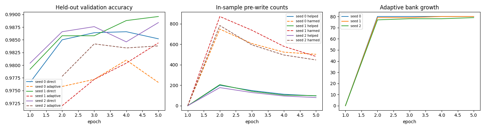
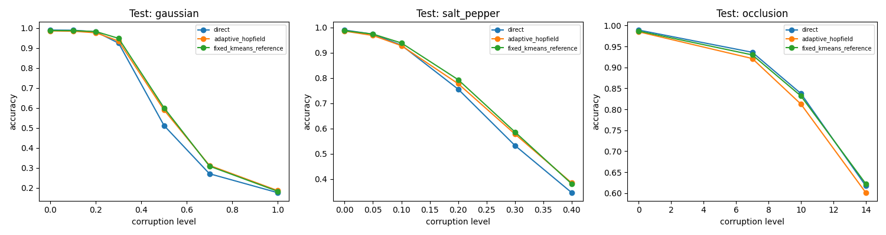

# Experiment 1: completed MNIST results

Experiment: `exp_001_online_accuracy_guided_memory`. Source run: `dcee52a0d8484d75a46cc9b426940a39`.

Three seeds (0, 1, 2), five epochs each, including one warm-up epoch. Per seed: 55,000 training, 5,000 validation, and 10,000 test images. Both memory methods use beta=5, one retrieval update, and at most eight entries per class. No validation beta tuning or automatic checkpoint selection was performed.

## Main result

The direct CNN has the highest mean clean accuracy and occlusion robustness AUC. Adaptive memory improves Gaussian and salt-and-pepper robustness over direct, but reduces clean and occlusion performance. The fixed K-means reference exceeds adaptive memory on all four aggregate metrics below. Three seeds support descriptive comparisons, not strong across-seed statistical claims.

| Method | Clean accuracy mean +/- sample SD | Gaussian AUC | Salt-and-pepper AUC | Occlusion AUC |
| --- | --- | --- | --- | --- |
| Direct CNN | 98.923% +/- 0.231 pp | 0.5810 | 0.7230 | 0.8793 |
| Adaptive Hopfield | 98.507% +/- 0.251 pp | 0.6089 | 0.7432 | 0.8643 |
| Fixed K-means | 98.680% +/- 0.052 pp | 0.6128 | 0.7516 | 0.8757 |

AUC is normalized area under accuracy versus corruption severity on a 0-1 scale; higher is better. It is not ROC AUC.

| Seed | Direct CNN | Adaptive Hopfield | Fixed K-means |
| --- | --- | --- | --- |
| 0 | 98.66% | 98.23% | 98.71% |
| 1 | 99.09% | 98.72% | 98.62% |
| 2 | 99.02% | 98.57% | 98.71% |

## Corruption accuracy: means across seeds

| Corruption | Level | Direct CNN | Adaptive Hopfield | Fixed K-means |
| --- | --- | --- | --- | --- |
| Clean | 0 | 98.92% | 98.51% | 98.68% |
| gaussian | 0.1 | 98.84% | 98.34% | 98.64% |
| gaussian | 0.2 | 98.06% | 97.57% | 98.18% |
| gaussian | 0.3 | 92.36% | 93.39% | 94.76% |
| gaussian | 0.5 | 51.14% | 58.90% | 60.01% |
| gaussian | 0.7 | 27.01% | 31.19% | 30.83% |
| gaussian | 1.0 | 17.56% | 18.61% | 18.25% |
| salt_pepper | 0.05 | 97.28% | 96.78% | 97.34% |
| salt_pepper | 0.1 | 92.94% | 92.75% | 93.82% |
| salt_pepper | 0.2 | 75.55% | 77.70% | 79.29% |
| salt_pepper | 0.3 | 53.26% | 57.80% | 58.62% |
| salt_pepper | 0.4 | 34.60% | 38.43% | 38.08% |
| occlusion | 7 | 93.62% | 92.13% | 93.00% |
| occlusion | 10 | 83.77% | 81.25% | 83.19% |
| occlusion | 14 | 61.72% | 60.11% | 62.23% |

Gaussian levels are sigma; salt-and-pepper levels are probabilities; occlusion levels are square side lengths in pixels.

## Clean per-digit accuracy: means across seeds

| Digit | Direct CNN | Adaptive Hopfield | Fixed K-means |
| --- | --- | --- | --- |
| 0 | 99.52% | 99.01% | 99.35% |
| 1 | 99.62% | 99.06% | 99.41% |
| 2 | 99.19% | 98.68% | 99.22% |
| 3 | 99.31% | 98.38% | 99.24% |
| 4 | 98.37% | 98.51% | 98.64% |
| 5 | 98.84% | 98.65% | 98.77% |
| 6 | 98.92% | 99.37% | 99.23% |
| 7 | 98.51% | 97.86% | 98.31% |
| 8 | 99.35% | 97.67% | 97.95% |
| 9 | 97.52% | 97.85% | 96.60% |

## Paired clean comparisons

| Seed | Method | Helped | Harmed | Delta vs direct (pp) | McNemar p |
| --- | --- | --- | --- | --- | --- |
| 0 | Adaptive Hopfield | 37 | 80 | -0.43 | 8.71744e-05 |
| 0 | Fixed K-means | 42 | 37 | +0.05 | 0.652964 |
| 1 | Adaptive Hopfield | 28 | 65 | -0.37 | 0.000157571 |
| 1 | Fixed K-means | 24 | 71 | -0.47 | 1.4641e-06 |
| 2 | Adaptive Hopfield | 31 | 76 | -0.45 | 1.60286e-05 |
| 2 | Fixed K-means | 25 | 56 | -0.31 | 0.000752126 |

Adaptive repaired 96 direct errors and introduced 221 new errors, giving 125 additional errors over three 10,000-image evaluations. Fixed repaired 91 and introduced 164, giving 73 additional errors. These evaluations reuse the same test images across seeds. McNemar p-values are per seed and unadjusted for multiple comparisons.

## Training and validation

| Epoch | Mean direct CE loss | Validation direct | Validation adaptive |
| --- | --- | --- | --- |
| 1 | 0.1907 | 97.87% | Unavailable |
| 2 | 0.0517 | 98.58% | 97.52% |
| 3 | 0.0343 | 98.66% | 97.95% |
| 4 | 0.0249 | 98.67% | 98.16% |
| 5 | 0.0192 | 98.77% | 98.16% |

Epoch 1 has an empty bank, so genuine Hopfield validation accuracy is unavailable. The final epoch is used for test evaluation. Training-time write diagnostics are in-sample; validation results and final test results have separate denominators.

## Bank, costs, and verification

| Seed | Adaptive entries | Successful writes | Fallback exposures | Capacity skips |
| --- | --- | --- | --- | --- |
| 0 | 80 | 1549 | 128 | 841 |
| 1 | 80 | 1566 | 128 | 1112 |
| 2 | 79 | 1440 | 128 | 889 |

Across all seeds: 660,000 post-warm-up exposures, 659,616 genuine comparisons, 384 bootstrap fallbacks, and 4,555 successful writes (30 seeds, 209 adds, 4,316 merges). Capacity blocked 2,842 of 7,367 eligible active candidates (38.6%). All classes were covered; seed 2 has seven entries for digit 6. Every fixed bank has 80 entries.

Recorded training-loop wall time was 29.96 minutes across three seeds; final test evaluation took 5.35 minutes. Training wall time already includes forward/backward, retrieval, writes, and in-loop diagnostics and logging. Component timers overlap with it and must not be summed as independent costs. CPU with four threads was used.

Each adaptive bank allocated 22,016 bytes of tensors, plus serialized metadata. Recorded checkpoints total 84.84 MiB and compressed logs total 12.45 MiB. Full timing, storage, attention, drift, per-class, confusion, and paired statistics for every seed and corruption condition are retained in [full structured results](recorded_results/full_results.json).

[Verification](recorded_results/verification.json) records unchanged original src, matching source identity, and exact replay of all three final banks from mutation records. The primary manifest records completion; no numerical failure was recorded.

## Interpretation and next comparison

The [separate diagnosis](DIAGNOSIS.md) found no accuracy-causing defect in the audited paths. Sharpening the saved adaptive bank and freezing the encoder did not resolve the gap. Alternative endpoint bank construction improved validation performance without closing the direct-path gap. Those controls do not establish the outcome of a real during-training admission ablation.

The next comparison is original accuracy-gated admission versus every directly correct training example, holding the other settings fixed. Alpha, capacity, initialization/refresh, epochs, and blending are subsequent separately identified comparisons, selected using validation data.

## Plots and saved evidence

[Resolved configuration](recorded_results/full_config.yaml) | [Primary source and environment manifest](recorded_results/full_manifest.json) | [Export hashes and original paths](recorded_results/manifest.json) | [Readout diagnosis](recorded_results/readout_diagnosis.md) | [Frozen control](recorded_results/frozen_encoder.md) | [Matched bank control](recorded_results/matched_banks.md)
