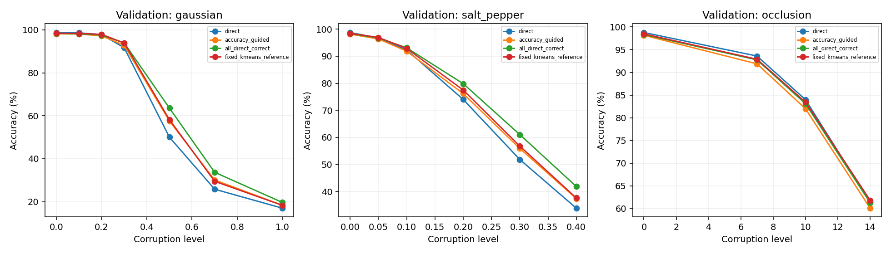

# Step 1: broader online admission

Variant: `exp001_step01_online_all_direct_correct_admission`. Completed seeds: 0, 1, 2. These are validation results; the official test dataset was not opened.

## Outcome

Broader admission improves mean clean validation accuracy from **98.160% to 98.320%**, a gain of **0.160 percentage points**. The direct CNN remains higher at **98.773%**. The new bank has the highest Gaussian and salt-and-pepper robustness AUC among the four methods in this comparison. The clean-accuracy problem remains unresolved.

The new rule makes 24 fewer errors than the original bank across 15,000 seed-image validation evaluations, while making 68 more errors than direct. Validation sets can overlap between seeds; these are not 15,000 distinct images. Three seeds provide descriptive evidence, not strong across-seed significance.

## Controlled change

The original policy considers a candidate when the direct CNN is correct and retrieval is wrong. The new policy also considers examples where both paths are correct. Directly wrong examples still train the CNN through direct cross-entropy but cannot update the bank.

Both paths continue from each original empty-bank warm-up checkpoint with the same model, Adam state, training/validation IDs, and private shuffle state. The encoder and classifier continue learning. Alpha=0.1, maximum eight entries per digit, beta=5, distance threshold=0.2, five total epochs including one warm-up, and the ordered snapshot/EMA/add/full-skip rules remain fixed. No hyperparameter or checkpoint search was performed.

Both adaptive banks use the frozen warm-up training center. The fixed reference uses its post-training training center and the identical final CNN. Actual original-bank occupancies are 80/80/79; new-bank and fixed-reference occupancies are 80/80/80.

## Final clean validation accuracy

| Method | Seed 0 | Seed 1 | Seed 2 | Mean +/- sample SD |
| --- | --- | --- | --- | --- |
| Direct CNN | 98.52% | 98.96% | 98.84% | 98.773% +/- 0.227 pp |
| Original accuracy-guided | 97.66% | 98.44% | 98.38% | 98.160% +/- 0.434 pp |
| All directly correct | 97.82% | 98.68% | 98.46% | 98.320% +/- 0.447 pp |
| Fixed K-means | 98.32% | 98.54% | 98.52% | 98.460% +/- 0.122 pp |

New minus original is +0.16, +0.24, and +0.08 percentage points for seeds 0, 1, and 2. The mean gap to direct is still -0.453 percentage points. Final-epoch results are retained even when an earlier checkpoint scored higher.

## Normalized validation robustness AUC

| Method | Gaussian | Salt-and-pepper | Occlusion |
| --- | --- | --- | --- |
| Direct CNN | 0.573300 | 0.712837 | 0.878779 |
| Original accuracy-guided | 0.601357 | 0.731171 | 0.864310 |
| All directly correct | 0.626530 | 0.761613 | 0.872343 |
| Fixed K-means | 0.603753 | 0.739717 | 0.874795 |

Higher is better, on a 0-1 scale. AUC integrates accuracy over the configured corruption grid; it is not ROC AUC. Relative to original admission, the new rule gains 2.517 pp on Gaussian AUC, 3.044 pp on salt-and-pepper AUC, and 0.803 pp on occlusion AUC. Direct still has the highest occlusion AUC.



## Memory behavior and cost

| Seed | Active entries | Successful writes | Prototype own-class checks | Elapsed minutes |
| --- | --- | --- | --- | --- |
| 0 | 80 | 211912 | 80/80 | 31.62 |
| 1 | 80 | 211478 | 80/80 | 43.33 |
| 2 | 80 | 211136 | 80/80 | 34.97 |

The new bank accepted **634,526 writes**, compared with **4,555** originally: **139.3 times as many**. More admissions change update frequency as well as sample coverage. This comparison measures that entire intervention; it does not isolate those two mechanisms.

All 240 new prototypes are individually classified as their stored class by the final classifier. That check does not guarantee that retrieval will classify every query correctly.

Allocated bank tensors remain 22,016 bytes per seed. The per-write diagnostics, full-vector logs, and replay audits add substantial experimental overhead. Worker elapsed times overlap because seeds ran in independent processes; they must not be summed as total wall time. Detailed component costs and log/checkpoint storage are in the structured results.

## Verification

- All 12 continued epoch checkpoints match the original CNN, Adam, and shuffle states exactly.
- All 24 original direct/adaptive clean-validation comparisons reproduce their saved accuracies, confusion matrices, and paired counts.
- All 660,000 post-warm-up example records and 634,526 mutations were audited; all three final banks replay exactly.
- Original checkpoint/reference hashes were rechecked after the runs.
- The exact training source tree is archived and its source fingerprint verified.
- The full regression suite passes: **427 tests**.
- Uncommitted worker tails are excluded from the combined report.

## Interpretation and next stage

The EMA formula was unchanged, and broader admission improved this comparison. That supports changing bank construction as a useful direction, while leaving a clean-accuracy gap. It does not establish that constant alpha is the main remaining cause, or that the broader memory idea cannot work.

The subsequent [alpha comparison is now complete](STEP02_ALPHA.md): alpha=0.03, 0.1, and 0.3 with admission policy, beta, capacity, and epochs held fixed. Alpha=0.03 wins the clean-first validation rule by 0.053 percentage points over 0.1, leaving a 0.400-point deficit to direct. Its full results and limits are kept separate from this admission comparison.

## Artifacts and reproduction

[Detailed report](recorded_results/admission_step1/report.md) | [Full metrics, per-class scores and confusion matrices](recorded_results/admission_step1/results.json) | [Per-condition CSV](recorded_results/admission_step1/results.csv) | [Verification](recorded_results/admission_step1/verification.json) | [Export hashes](recorded_results/admission_step1/export_manifest.json) | [Exact training source](recorded_results/admission_step1/training_source.zip)

Full checkpoints and event/vector logs remain local under the worker directories recorded in the manifest. The serial worker completed seeds 0/1; the independent worker completed seed 2. Its uncommitted serial seed-2 tail is excluded. Aggregation checks source/data/config compatibility, unique audited seeds, complete epoch histories, and unchanged original artifacts.

```powershell
python -B "experiment-id 1/admission_ablation.py" --run-dir <original_full_run_directory>
python -B "experiment-id 1/admission_ablation.py" --aggregate <worker_run_directory> <other_worker_directory>
python -B -m pytest tests "experiment-id 1/tests" -q
```
