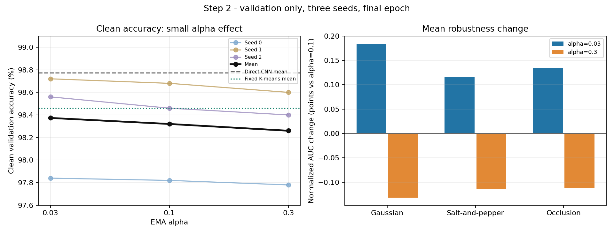
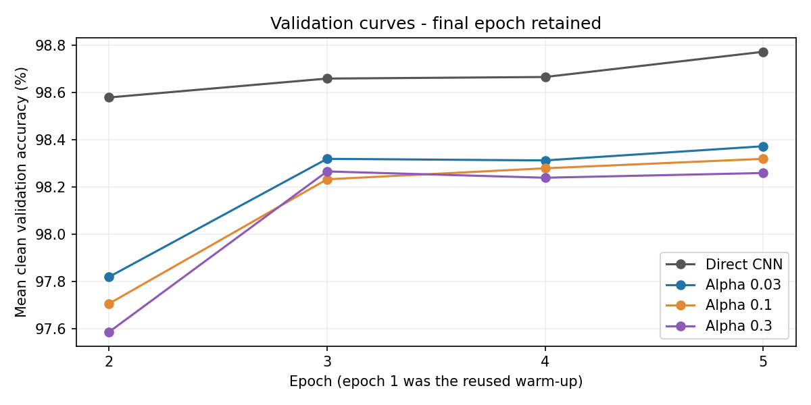
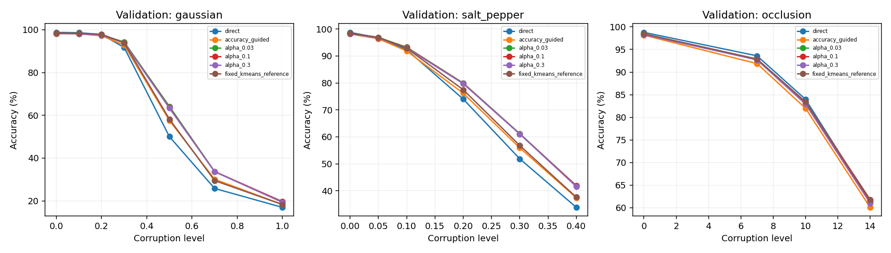

# Step 2: alpha tuning gives a small improvement

The completed three-seed comparison selects **alpha=0.03**, following the
predeclared preference for clean validation accuracy. It improves mean clean
accuracy from **98.320% to 98.373%**: **8 additional correct predictions across
15,000 seed-image evaluations**. Direct CNN accuracy remains **98.773%**.
Changing alpha helps slightly; it does not resolve the clean-accuracy gap.

These are **validation results**, separate from the original experiment's test
results. Each seed has 5,000 validation images. The splits partially overlap:
there are 13,814 distinct image IDs across 15,000 seed-image evaluations, so
these are not 15,000 independent images. The official test set was
not used for evaluation or selection in this comparison.

## Controlled comparison

Variant: `exp001_step02_all_correct_alpha_sweep`.

- Compare alpha **0.03, 0.1, 0.3** with Step 1's **all-direct-correct** admission.
- Seeds 0/1/2; 55,000 training and 5,000 validation examples per seed, with the
  original split IDs and original empty-bank warm-up checkpoints.
- Five total epochs, including one reused warm-up epoch; retain the final epoch.
- Eight prototypes per digit, beta=5, one retrieval update, centered cosine
  distance, threshold=0.2, epsilon=1e-8, and frozen warm-up centers.
- Adam learning rate 0.001 and direct-path cross-entropy remain unchanged.
  Memory has no optimizer parameters or gradient path to the CNN.

One actual CNN training trajectory supplies identical detached embeddings to
three independent banks per seed. This factors identical CNN computation;
existing backbone feature caches are not used. The alpha=0.1 control must
exactly reproduce Step 1 after every epoch. Fixed K-means and original
accuracy-guided comparators are reused with the identical final CNN.

Selection maximizes the total number of correct clean-validation predictions.
Exact ties would use mean corruption AUC, then closeness to 0.1, then smaller
alpha. There was no tie. This tunes a constant alpha; it does not learn alpha
through backpropagation. The [protocol](STEP02_ALPHA_PROTOCOL.md) was fixed
before training, and its original version is in the training source archive.

## Clean validation accuracy

| Method | Seed 0 | Seed 1 | Seed 2 | Mean | Correct / 15,000 |
|---|---:|---:|---:|---:|---:|
| Direct CNN | 98.52% | 98.96% | 98.84% | 98.773% | 14,816 |
| Original accuracy-guided admission, alpha=0.1 | 97.66% | 98.44% | 98.38% | 98.160% | 14,724 |
| All-direct-correct, **alpha=0.03** | **97.84%** | **98.72%** | **98.56%** | **98.373%** | **14,756** |
| All-direct-correct, alpha=0.1 | 97.82% | 98.68% | 98.46% | 98.320% | 14,748 |
| All-direct-correct, alpha=0.3 | 97.78% | 98.60% | 98.40% | 98.260% | 14,739 |
| Fixed K-means reference | 98.32% | 98.54% | 98.52% | 98.460% | 14,769 |

Against alpha=0.1, alpha=0.03 gains **0.02, 0.04, and 0.10 percentage points**
on the three seeds: one, two, and five additional correct predictions.
Alpha=0.3 loses 0.04, 0.08, and 0.06 points. The smaller alpha wins every seed
in this grid, but the differences are small.

Alpha=0.03 still makes **60 more errors than direct** and **13 more than fixed
K-means** across the three evaluations. Broader admission had reduced the
original clean error gap from 92 to 68; alpha tuning reduces it from 68 to 60.

## Noise robustness

Mean normalized accuracy AUC across seeds; higher is better. This integrates
accuracy over the configured corruption-strength range and is **not ROC AUC**.

| Method | Gaussian | Salt-and-pepper | Occlusion |
|---|---:|---:|---:|
| Direct CNN | 0.573300 | 0.712837 | 0.878779 |
| Original accuracy-guided admission | 0.601357 | 0.731171 | 0.864310 |
| All-direct-correct, **alpha=0.03** | **0.628373** | **0.762767** | **0.873693** |
| All-direct-correct, alpha=0.1 | 0.626530 | 0.761613 | 0.872343 |
| All-direct-correct, alpha=0.3 | 0.625217 | 0.760475 | 0.871231 |
| Fixed K-means reference | 0.603753 | 0.739717 | 0.874795 |

Alpha=0.03 improves all three mean AUCs over 0.1, by **0.001843, 0.001154,
and 0.001350**. Per-seed robustness changes are mixed: for example, seed 2's
Gaussian and salt-and-pepper AUCs decrease. The selected adaptive bank beats
direct and fixed on mean Gaussian and salt-and-pepper AUC, but remains below
both on occlusion AUC. Clean accuracy remains below both comparators.

## Paired clean results for alpha=0.03

Helped means direct was wrong and memory was correct. Harmed means direct was
correct and memory was wrong. These comparisons use the batch-independent,
read-only final validation predictions.

| Seed | Helped | Harmed | Both correct | Both wrong | Delta vs direct (pp) | McNemar p |
|---|---:|---:|---:|---:|---:|---:|
| 0 | 12 | 46 | 4,880 | 62 | -0.68 | 0.00000822 |
| 1 | 13 | 25 | 4,923 | 39 | -0.24 | 0.07295 |
| 2 | 9 | 23 | 4,919 | 49 | -0.28 | 0.02006 |

Overall it repairs **34** direct errors and introduces **94**, giving the
60-error deficit. The identity `delta=(helped-harmed)/N` is verified. These
p-values compare each bank with direct, not alpha=0.03 with alpha=0.1; they
are per-seed and unadjusted. No pooled significance or strong across-seed
claim is made.

## Training, memory, and costs

Each alpha has 660,000 post-warm-up exposure records across seeds: 659,616
genuine pre-write comparisons and 384 bootstrap fallbacks. Repeated exposures
are not distinct examples. The table below describes training; it is separate
from final validation accuracy.

| Alpha | Seeds | Adds | EMA merges | Successful writes | Capacity skips | In-sample helped | In-sample harmed |
|---|---:|---:|---:|---:|---:|---:|---:|
| 0.03 | 30 | 210 | 633,088 | 633,328 | 19,604 | 1,579 | 5,270 |
| 0.1 | 30 | 210 | 634,286 | 634,526 | 18,406 | 1,524 | 5,914 |
| 0.3 | 30 | 210 | 634,141 | 634,381 | 18,551 | 1,476 | 6,114 |

Every bank finishes with **80 entries, eight per digit**. All **720 prototypes**
across the nine banks are individually classified as their stored class by the
final classifier. Retrieval can still be wrong because it combines entries
from multiple classes. Correct individual prototypes do not guarantee correct
query predictions.

Each bank has 20,480 active vector bytes and 22,016 allocated tensor bytes,
plus 17,862-17,883 bytes of serialized metadata. These figures exclude process
memory, transient snapshots, and logging buffers; serialized metadata is not
Python heap usage. Ages and accepted-exposure counts are in the structured data.

| Seed | Committed training-loop minutes | Corruption evaluation minutes | Replay audit minutes | Committed elapsed minutes |
|---|---:|---:|---:|---:|
| 0 | 44.08 | 1.35 | 3.42 | 49.34 |
| 1 | 44.05 | 1.36 | 3.38 | 49.29 |
| 2 | 39.73 | 0.46 | 2.30 | 42.76 |

Wall time from the first source archive to the last worker's completion was
approximately **67.63 minutes**, including the interruption below. Workers ran
concurrently for part of the study. Their elapsed times cannot be summed as
wall time; component timers also overlap with training-loop timers. The reused
warm-up and fixed-reference construction are not charged again. Runtime costs
include extensive experimental logging and auditing and are not an optimized
production benchmark.

Committed compressed logs occupy **641.0 MB** and checkpoints **69.7 MB** in
logical file bytes. NTFS compression can reduce physical allocation. Detailed
forward/backward, assignment, writes, retrieval, logging, and validation costs
are included per seed and per alpha in the JSON.

### Disk interruption and recovery

The free-space reserve stopped all three workers during epoch 5. Epoch 4 and
its committed cursors remained intact. Cached MNIST files and checkpoint files
were losslessly compressed at the filesystem level. Only **112.78 MB** of
uncommitted tail chunks excluded by the saved cursors were removed, with their
paths and hashes recorded. No committed records were deleted.

All workers resumed from epoch 4. The discarded partial attempts contained
350, 350, and 200 optimizer updates; these are excluded from final histories
and metrics. Final CNN/Adam/shuffle and alpha=0.1 bank equality checks passed.
All nine banks then replayed exactly from their committed logs, including
resumed mutations. Per-component timings describe committed work; the wall
time includes the discarded work. This was an operational interruption;
**no numerical failure** was recorded.

## Verification and interpretation

- **450 tests passed**, including deterministic CPU resume, trajectory parity,
  alpha policy, lossless residual coding, independent replay, and integration.
- All **12** continued CNN/Adam/shuffle checkpoints and alpha=0.1 banks match
  their saved reference states exactly.
- All **1,980,000 exposure records** and **1,902,235 successful mutations** pass
  independent policy/EMA audits; all nine final banks replay exactly.
- All **306 validation rows** satisfy confusion, per-class, paired-count,
  delta-accuracy, and AUC identities.
- All **33 protected artifact hashes** and all three archived source trees
  verify. The exact training source is exported.
- Original `src` and `benchmarks` remain unchanged from the audited main checkout.

These checks found no implementation error explaining the accuracy deficit.
They do not prove that every possible bug has been excluded. Within this grid,
larger EMA steps worsen clean accuracy, while smaller steps improve it slightly.
The remaining gap is much larger than the alpha gain, so tuning constant alpha
alone is insufficient here. This result does not establish that Hopfield memory
cannot work.

The subsequent [8-versus-16 capacity comparison is now complete](STEP03_CAPACITY.md).
It uses alpha=0.03 with admission, beta, threshold, epochs, CNN training, and
validation selection rules held fixed. Sixteen slots improves mean clean
validation accuracy to 98.480% with a Gaussian/salt-and-pepper robustness
tradeoff. Its results remain separate from this alpha comparison. Under the
clean-first priority, the direct CNN remains the best measured method.

The frozen warm-up center, representation drift, different center timing for
the fixed bank, in-sample admission, reuse of validation across stages, and only
three seeds limit the conclusions. A future test evaluation must follow final
configuration choices; no new test performance is claimed here.

## Evidence and reproduction

[Full structured metrics, per-class accuracy and confusion matrices](recorded_results/alpha_step2/results.json)
| [Per-condition CSV](recorded_results/alpha_step2/results.csv)
| [Derived counts, costs and storage](recorded_results/alpha_step2/analysis_summary.json)
| [Verification](recorded_results/alpha_step2/verification.json)
| [Selection](recorded_results/alpha_step2/selection.json)
| [Manifest](recorded_results/alpha_step2/manifest.json)
| [Resolved bank settings](recorded_results/alpha_step2/resolved_settings.json)
| [Export hashes](recorded_results/alpha_step2/export_manifest.json)
| [Exact training source](recorded_results/alpha_step2/training_source.zip)
| [Discarded tail record](recorded_results/alpha_step2/discarded_tails.json)

Full checkpoints, split IDs, and event/vector chunks remain local in the worker
directories listed in the manifest. The combined run is
`results/variants/alpha_comparison_20261104_01`; raw artifacts are ignored by Git.

```powershell
python -B "experiment-id 1/alpha_ablation.py" --step1-run <completed_step1_comparison_directory>
python -B "experiment-id 1/alpha_ablation.py" --resume <alpha_worker_directory>
python -B "experiment-id 1/alpha_ablation.py" --aggregate <worker_seed0_directory> <worker_seed1_directory> <worker_seed2_directory>
python -B -m pytest tests "experiment-id 1/tests" -q
```

Immediate per-write before/after prediction diagnostics were disabled equally
for all alphas and are explicitly unavailable. Pre-write batch decisions and
whole-batch post-write diagnostics remained enabled. Candidate/old/new vectors
remain recoverable bit for bit through the documented residual codec; the
audits independently verify the decoded values.






