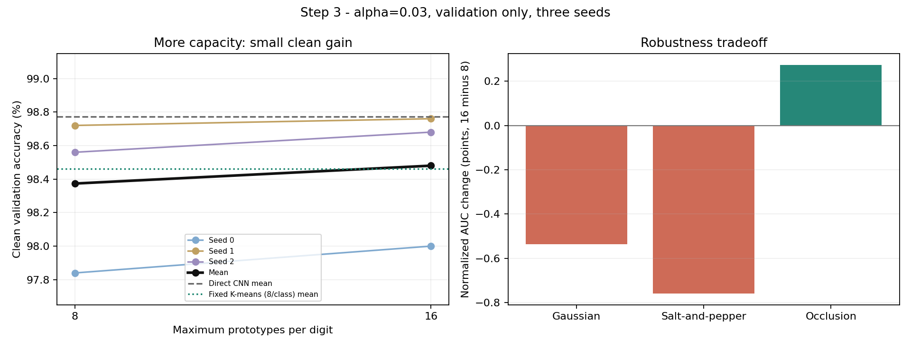
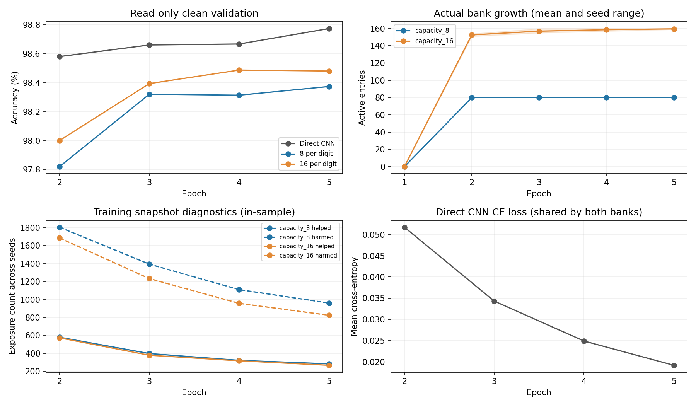
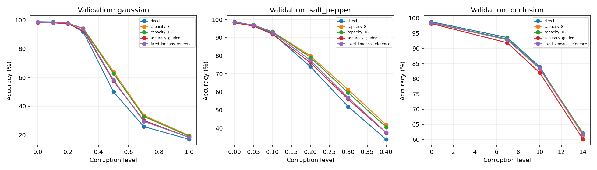

# Step 3: more capacity helps clean accuracy, with a noise tradeoff

The completed three-seed comparison selects **16 maximum prototypes per digit**
under the predeclared clean-first rule. At alpha=0.03, mean clean validation
accuracy increases from **98.373% to 98.480%**: **16 additional correct
predictions across 15,000 seed-image evaluations**. Direct CNN accuracy remains
**98.773%**, leaving **44 additional errors** for adaptive memory.

Occlusion robustness improves, while Gaussian and salt-and-pepper robustness
decrease. This is a modest partial improvement. It does not establish a complete
solution to the clean-accuracy deficit or an independent test improvement.

## Protocol and controls

Variant: `exp001_step03_all_correct_capacity_comparison`.

Compare capacities **8 and 16**, with alpha **0.03** selected in Step 2. Keep
all-direct-correct admission, beta=5, one retrieval update, centered cosine
distance, threshold=0.2, epsilon=1e-8, frozen warm-up centers, no refresh or
eviction, and direct-only CNN cross-entropy unchanged. Use Adam 0.001, batch
size 128, evaluation batch size 256, and four CPU threads.

Use seeds 0/1/2 and the original 55,000/5,000 training/validation IDs for each
seed. Five total epochs include the reused one-epoch warm-up. Retain the final
epoch without checkpoint search. The 15,000 validation evaluations involve
**13,814 distinct image IDs** because splits partially overlap between seeds.
Each model's own training and validation sets are disjoint. The official test
set was not used for evaluation or selection in this stage.

Independent banks share one actual CNN training trajectory per seed, receiving
the same detached minibatch embeddings. Existing backbone feature caches are
not used. Each bank starts empty with only the same frozen warm-up center;
active prototypes are never copied or duplicated into the larger bank.

At every epoch, require exact CNN/Adam/shuffle agreement with the original run
and exact eight-slot bank agreement with Step 2's alpha=0.03 bank, including
buffers, center, IDs, metadata, decisions, counters, and validation metrics.
The [protocol](STEP03_CAPACITY_PROTOCOL.md) was fixed before training; its
original version is included in the training source archive.

## Clean validation accuracy

| Method | Seed 0 | Seed 1 | Seed 2 | Mean | Correct / 15,000 |
|---|---:|---:|---:|---:|---:|
| Direct CNN | 98.52% | 98.96% | 98.84% | **98.773%** | 14,816 |
| Adaptive, 8 per digit, alpha=0.03 | 97.84% | 98.72% | 98.56% | 98.373% | 14,756 |
| Adaptive, **16 per digit, alpha=0.03** | **98.00%** | **98.76%** | **98.68%** | **98.480%** | **14,772** |
| Original accuracy-guided admission | 97.66% | 98.44% | 98.38% | 98.160% | 14,724 |
| Fixed K-means, 8 per digit | 98.32% | 98.54% | 98.52% | 98.460% | 14,769 |

Increasing capacity gains **0.16, 0.04, and 0.12 percentage points** on the three
seeds: eight, two, and six additional correct predictions. The mean gain is
**0.107 points**. Clean accuracy wins the selection directly; no AUC tiebreaker
is needed.

The selected bank makes **44 more errors than direct**, versus 60 for the
eight-slot bank. It makes three fewer errors than the fixed reference, but the
fixed reference has 80 entries while the larger adaptive banks have 159-160.
A matching 160-entry fixed reference would be needed for a comparison at the
same memory budget. Fixed centers remain the post-training training mean;
adaptive centers remain the warm-up training mean.

## Paired 16-versus-8 results

Here, helped means 16 slots corrected an eight-slot error; harmed means 16 slots
broke an eight-slot correct prediction. These are final, read-only clean
validation predictions.

| Seed | Helped | Harmed | Both correct | Both wrong | Net gain | McNemar p |
|---|---:|---:|---:|---:|---:|---:|
| 0 | 11 | 3 | 4,889 | 97 | +8 | 0.05737 |
| 1 | 6 | 4 | 4,932 | 58 | +2 | 0.75391 |
| 2 | 10 | 4 | 4,924 | 62 | +6 | 0.17957 |

Across the three evaluations, 16 slots repair **27** eight-slot errors and
introduce **11**, giving the 16-case gain. The gain is small; these per-seed,
unadjusted tests do not establish strong statistical evidence. No pooled
significance claim is made.

Against direct, the selected bank repairs **30** errors and introduces **74**.
The eight-slot bank repairs 34 and introduces 94. The net improvement therefore
comes from fewer harmed direct predictions, alongside fewer repaired direct
errors. Per-seed comparisons against direct are retained in the JSON and CSV.

## Robustness AUC

Mean normalized accuracy AUC across seeds; higher is better. This integrates
accuracy over corruption strength and is not ROC AUC.

| Method | Gaussian | Salt-and-pepper | Occlusion |
|---|---:|---:|---:|
| Direct CNN | 0.573300 | 0.712837 | 0.878779 |
| Adaptive, 8 per digit | 0.628373 | 0.762767 | 0.873693 |
| Adaptive, 16 per digit | 0.623020 | 0.755183 | 0.876438 |
| Original accuracy-guided admission | 0.601357 | 0.731171 | 0.864310 |
| Fixed K-means, 8 per digit | 0.603753 | 0.739717 | 0.874795 |

Relative to eight slots, the changes are **-0.005353 Gaussian**, **-0.007583
salt-and-pepper**, and **+0.002745 occlusion**. The direction is the same in all
three seeds. Both adaptive capacities beat direct on Gaussian and salt-and-pepper
AUC and remain below direct on occlusion AUC.

The clean-first preference selects 16 despite the Gaussian/salt-and-pepper
tradeoff. The eight-slot checkpoint remains available for comparisons that
prioritize those noise families. All per-strength accuracies, per-class scores,
confusion matrices, and paired results are in the structured artifacts.

## Actual bank sizes and writes

Capacity is a limit, not forced occupancy.

| Seed | Eight-slot entries | Sixteen-slot entries | Sixteen-slot entries classified as own class |
|---|---:|---:|---:|
| 0 | 80 | 159 | 159/159 |
| 1 | 80 | 160 | 159/160 |
| 2 | 80 | 160 | 160/160 |

Seed 0 has 15 entries for digit 1 and 16 for every other digit. All 240 control
prototypes classify as their stored class; 478 of 479 larger-bank prototypes do.
Numerical validity and class-label provenance pass for every stored entry.

Each capacity has **660,000 post-warm-up exposure records**, **659,616 genuine
pre-write comparisons**, and **384 bootstrap fallbacks** across seeds. Repeated
exposures are not distinct training images.

| Maximum per digit | Seeds | Adds | EMA merges | Successful writes | Capacity skips |
|---|---:|---:|---:|---:|---:|
| 8 | 30 | 210 | 633,088 | 633,328 | 19,604 |
| 16 | 30 | 449 | 640,304 | 640,783 | 12,149 |

The larger bank accepts **7,455 additional writes**. Capacity changes available
representatives, assignments, write frequency, and support per entry; these are
consequences of the capacity intervention. Alpha and the admission rule stay
fixed. Training snapshot helped/harmed counts, post-write diagnostics, loss,
ages, accepted exposures, and saturation remain separate from validation scores.

Clean retrieval attention also changes with entry count:

| Maximum per digit | Mean entropy (nats) | Mean entropy / log(actual entries) | Mean top-1 attention mass |
|---|---:|---:|---:|
| 8 | 2.844411 | 0.649109 | 0.145755 |
| 16 | 3.568719 | 0.703467 | 0.085622 |

Raw entropy depends on the number of entries. These diagnostics describe the
readout; they do not by themselves identify the cause of its accuracy changes.

## A concrete rare-entry example

This is a **post-hoc training example**, not a validation result or a proof of
the overall deficit's cause. In seed 1, larger-bank entry **157**, labelled
**digit 6**, has only two accepted exposures, both from original training
image **36653**. Its recorded history is:

| Epoch | Direct prediction | Larger-bank prediction before writes | Memory decision |
|---|---:|---:|---|
| 2 | 0 | 0 | Skip: direct incorrect |
| 3 | 6 | 6 | Add entry 157 beyond the distance threshold |
| 4 | 6 | 6 | Merge into entry 157 |
| 5 | 0 | 0 | Skip: direct incorrect |

The last write is step **1358**, leaving the entry unchanged for **792 optimizer
steps** before the run ends. The final classifier no longer classifies this
stored vector as 6; its own-class margin is **-0.05808**. The last admitted
candidate was directly correct, consistent with the policy. Immediate per-write
prototype predictions were disabled, so the exact moment its classification
changed is unavailable.

The admission rule correctly excludes the later directly incorrect candidate.
It also provides no refresh for this entry during the remaining interval.
Once an entry receives no further writes, its EMA is not applied; adjusting
alpha alone does not supply a refresh mechanism. More slots can retain rare
entries with little support. These observations help explain a limitation of
the recipe, while the precise effect of this particular entry on held-out
predictions has not been tested.

The eight-slot control has no individually misclassified prototypes and still
trails direct clean accuracy. This one rare entry cannot explain the entire
memory deficit. The [recorded source history](recorded_results/capacity_step3/seed1_source36653_history.json)
and [entry provenance](recorded_results/capacity_step3/seed1_entry157_provenance.json)
make the example reviewable without changing the original results.

## Costs and recovery

| Seed | Committed training minutes | Corruption evaluation minutes | Replay audit minutes | Committed elapsed minutes |
|---|---:|---:|---:|---:|
| 0 | 22.11 | 0.73 | 2.82 | 25.89 |
| 1 | 21.25 | 0.74 | 2.35 | 24.53 |
| 2 | 16.06 | 0.72 | 3.12 | 20.05 |

Study wall time from the first source archive to the last worker's completion
was **71.62 minutes**. Component timings overlap with training; worker timings
overlap during the initial parallel attempt. They must not be summed as
independent costs. Warm-up training and fixed-reference construction were
reused. Full forward/backward, retrieval, assignment, writes, logging, and
validation timers are retained in the JSON. Extensive instrumentation makes
these descriptive experimental costs rather than optimized production costs.

Windows could not allocate memory for seed 1 during the initial parallel
attempt. It stopped before its first continued epoch checkpoint. The remaining
workers ran sequentially. Seed 1 restarted from the original warm-up, excluding
the partial attempt's **322 optimizer updates**. Its uncommitted tail chunks
remain local and are excluded by the final committed cursors. All final control
checks and replays passed. No numerical failure was recorded, and no experiment
setting changed in response to the interruption.

Committed logs total **429.4 MB**, checkpoints **69.5 MB**, and excluded partial
tails **26.3 MB**, measured as logical file lengths. Physical NTFS allocation
can differ. Each eight-slot bank allocates **22,016 tensor bytes**; each
sixteen-slot bank allocates **43,776 bytes**, plus serialized metadata. Active
vectors, metadata sizes, ages, and complete storage accounting are in the JSON;
these bank figures do not represent total Python/PyTorch process memory.

## Verification and interpretation

- **467 tests passed**, including capacity behavior, direct-gradient parity,
  read-only evaluation, exact epoch resume, independent replay, and integration.
- All **12** continued CNN/Adam/shuffle and eight-slot bank checkpoints match
  their saved references exactly.
- All **six** banks replay exactly; **1,320,000 exposure records** and
  **1,274,111 mutations** pass independent assignment/EMA audits.
- All **255 evaluation rows** and **51 capacity-pair rows** satisfy count,
  confusion, per-class, delta-accuracy, and robustness-AUC identities.
- All **204 shared-comparator metric rows** reproduce Step 2 exactly.
- All **47 protected artifact hashes**, original split IDs, and three archived
  source trees verify. Original `src` and `benchmarks` remain unchanged from
  the audited main checkout.

This comparison found no implementation error explaining the accuracy gap.
The prescribed update math and ordering pass the audits. Capacity helps the
measured clean score, while Gaussian and salt-and-pepper results worsen.
The observed rare entry is a design limitation to investigate, not evidence of
a mislabeled write or a numerical failure.

Across the staged validation comparisons, clean adaptive accuracy has moved
from **98.160% original**, through **98.320% broader admission**, **98.373%
alpha tuning**, to **98.480% larger capacity**. The direct deficit shrinks from
92 to 44 errors across the three evaluations. The direct CNN remains the best
measured clean method. The small gains, reused validation, three seeds, frozen
center, representation drift, and different fixed/adaptive center timing limit
the conclusions. Further refresh, eviction, epoch, or readout variants remain
separate experiments; no outcome for them is claimed here.

## Artifacts and reproduction

[Full metrics, per-class accuracy and confusion](recorded_results/capacity_step3/results.json)
| [Per-condition CSV](recorded_results/capacity_step3/results.csv)
| [Derived counts, costs, per-class and attention summaries](recorded_results/capacity_step3/analysis_summary.json)
| [Verification and checkpoint hashes](recorded_results/capacity_step3/verification.json)
| [Selection](recorded_results/capacity_step3/selection.json)
| [Manifest](recorded_results/capacity_step3/manifest.json)
| [Resolved settings](recorded_results/capacity_step3/resolved_settings.json)
| [Export hashes](recorded_results/capacity_step3/export_manifest.json)
| [Exact training source](recorded_results/capacity_step3/training_source.zip)
| [Runtime interruption](recorded_results/capacity_step3/runtime_interruption.json)

The combined local run is `results/variants/capacity_comparison_20261105_01`.
Its manifest points to each worker's full checkpoints, split IDs, and committed
event/vector chunks. Those large artifacts remain local and ignored by Git.

```powershell
python -B "experiment-id 1/capacity_ablation.py" --step2-run <completed_step2_comparison_directory>
python -B "experiment-id 1/capacity_ablation.py" --resume <capacity_worker_directory>
python -B "experiment-id 1/capacity_ablation.py" --aggregate <worker_seed0_directory> <worker_seed1_directory> <worker_seed2_directory>
python -B -m pytest tests "experiment-id 1/tests" -q
```

Resume requires the exact training source/settings and protected inputs.
The archive preserves the source before these publication updates. Immediate
per-write predictions remain explicitly unavailable for both capacities;
pre-write snapshot and whole-batch post-write diagnostics remain enabled.
Candidate/old/new vectors are recoverable bit for bit from the residual codec.






